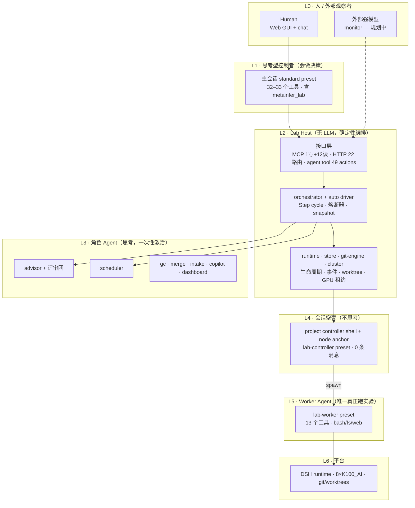

# 00 · 系统地图（入口）

> **读这一页的目的**：在 3 分钟内建立"这个系统分几层、Agent 在哪几层、某个事实该去哪查"的认知，避免从零散代码里反推。
>
> **维护约定**：本文**不复制**其他文档的事实，只做分层 + 索引 + 坑位。任何与代码不符之处，以代码为准，并在 `docs/issues/` 记一条。
>
> **最近核对**：2026-11-09 @ `867d277`，核对方法见 §5（可复现）。
> 核对过的结论才写进来；没核对过的写"待验证"。

---

## 1. 分层总览



**一句话记法**：`人 → 控制者 → 编排 → 角色 Agent / 空壳 → worker → 平台`。

## 2. Agent 分几层：3 层会思考 + 1 层空壳

| 层 | preset | 会思考？ | 实际工具（运行时 `request/header.tools`） | 数量证据 |
|---|---|---|---|---|
| L1 控制者 | `standard`（主会话，不是插件的 `controllerSessionId`） | ✅ | 32–33 个，含 `metainfer_lab` | 4 个会话 / 1238 条消息 |
| L3 角色 | `lab-advisor` | ✅ | `metainfer_lab`, `working_directory`, `structured_output` | 44 会话 / 117 条消息 |
| L3 角色 | `lab-scheduler` | ✅ | 同上 | 38 会话 / 120 条消息 |
| L3 角色 | `lab-gc` / `lab-merge` / `lab-intake` / `lab-chat` / `lab-dashboard` | ✅ | 见 `docs/02 §1` | — |
| L4 空壳 | `lab-controller`（项目 controller 与 node anchor 共用） | ❌ | 从不运行，**0 条 assistant 消息 / 0 次工具调用** | 75 会话 / 0 条 |
| L5 执行 | `lab-worker` | ✅ | 13 个（bash / fs / web / 结构化输出） | 72 会话 / 7357 条消息 |

**关于 L4 空壳**：它不是"偷懒的 agent"，而是**故意的会话容器**——DSH 的 sandbox 边界取父会话 `header.cwd`，worker 必须挂在一个 `cwd = worktree` 的父会话下才能被限制在节点工作目录内。设计说明见 [01-architecture.md](01-architecture.md) §7.3。

## 3. 三个入口，一个门面

```
MCP       /mcp/metainfer-research-lab      1 写 + 12 读      ← 外部客户端
HTTP      /api/metainfer-research-lab/*    22 路由 + /commands(29)
agent tool metainfer_lab                   49 actions         ← DSH 内的 agent
                          ↓
                    lab-service（唯一门面）
```

改任何写操作只需改 `lab-service`；接口层只负责鉴权、参数校验、呈现。

## 4. 四个坑（每条都对应一次真实事故，写在这里省一次调试）

1. **`metainfer_lab` 是全局注册的**，49 个 action（含 `delete_project`、`start_node`）在所有 preset 里都可见。只读行为靠 prompt 约束，不是工具级强制。
   → 见 [`docs/issues/0001-agent-tool-scope-drift.md`](issues/0001-agent-tool-scope-drift.md)。

2. **anchor 不调用 LLM**。看到 `lab-controller` 会话 0 消息是**正常**的，不要当成 bug 去"修"。

3. **重试会重置两个 session**。`prepareNewAttempt` 同时生成新的 `sessionId` **和** `anchorSessionId`（`host/runtime.js`），所以 anchor 不跨重试存活。

4. **commit 由 Host 做**，不是 worker。worker 只负责把改动留在自己的分支上，Host 在节点收尾时 `git.commitWorktree`。

## 5. 怎么核对（可复现）

工具清单不能只看源码——**代码声明**和**运行时实际下发**是两件事。用会话日志核对：

```bash
python3 - <<'PY'
import zstandard, json, glob
dctx = zstandard.ZstdDecompressor()
def load(f):
    with open(f,'rb') as fh:
        return [json.loads(l) for l in dctx.stream_reader(fh).read().decode('utf8','ignore').splitlines() if l.strip()]
res = {}
for d in sorted(glob.glob('/root/.dsh/sessions/*/session-*/session.v4.jsonl.zstd')):
    try: recs = load(d)
    except Exception: continue
    preset = recs[0].get('agentPreset') or '?'
    for r in recs:
        if r.get('type') != 'request/header': continue
        h = (r.get('data') or {}).get('header') or {}
        # 两种 schema 都存在，必须都查，否则得到空结果
        tools = h.get('tools') or (h.get('config') or {}).get('tools') or []
        if tools: res.setdefault(preset, set()).add(tuple(x['name'] for x in tools))
for p, s in sorted(res.items()):
    for t in s: print(p, len(t), ','.join(t))
PY
```

## 6. 权威源索引

| 想查 | 去哪 |
|---|---|
| 为什么这样设计、不变量、数据模型、节点状态机 | [01-architecture.md](01-architecture.md) |
| 五类 Agent 的分工与提示词、编排、预算、失败处理 | [02-agents-orchestration.md](02-agents-orchestration.md) |
| 界面信息架构与交互 | [03-ui-spec.md](03-ui-spec.md) |
| 范围/里程碑/验收 | [04-mvp-plan.md](04-mvp-plan.md) |
| 集群、模型路由、GPU 协调器 | [06-multi-tenant-and-model-routing.md](06-multi-tenant-and-model-routing.md) |
| 已知缺陷与设计漂移 | [issues/](issues/) |
| MCP 对外接口 | [../MCP.md](../MCP.md) |

## 7. 待验证 / 已知缺口

- `docs/02 §1` 声明 advisor/scheduler **无工具**，实际有 3 个（见 issue 0001）。
- `docs/02` 与 `lab-gc` persona 引用的 `lab_cleanup` 工具**在代码中不存在**（见 issue 0001）。
- 本文的表格目前**靠人工核对**，没有自动化守卫；计划在实现 `audit` action 后，把 §2 的工具列接进契约测试。
