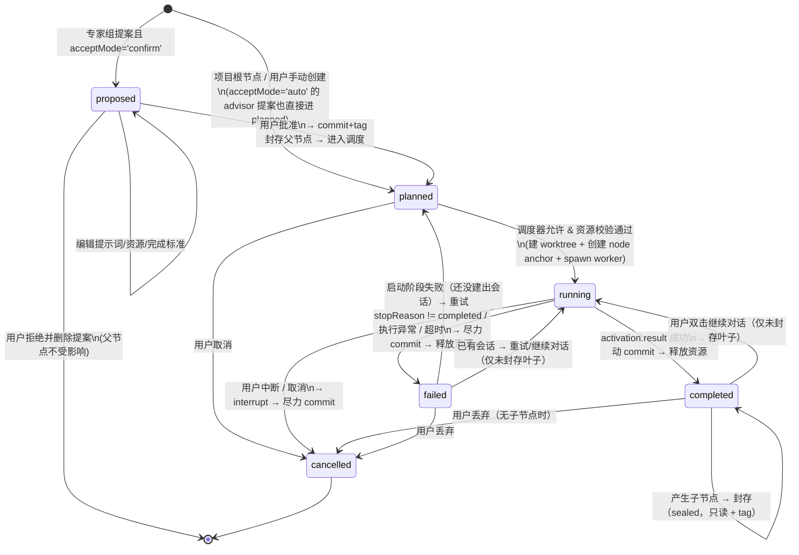

# 01 · 架构与领域模型

> 本文是 MVP 的「系统为什么这样设计」。所有 DSH API 结论均来自本机安装的 DSH 源码/类型（`$DSH_INSTALL/node_modules/@deepseek-ai/`），
> 文中以「证据」标注；实现时必须再以 `cordis_inspect_query` 复核一次。

---

## 1. 目标与设计立场

**目标**：把 DSH 变成科研实验 IDE —— 以 **动态 DAG** 组织实验，每个节点绑定 **git worktree + subagent 会话**，
由 **专家组 Agent** 生长 DAG、**调度 Agent** 分配资源，用户通过 **手动挡（Step）/ 自动挡** 推进，并保留清晰的迭代历史。

四条设计立场：

1. **Host 是唯一权威**。DAG 结构、节点状态、资源账本、Git 操作全部由 Host 插件完成；Client 只渲染和发送「意图」；
   LLM Agent 只产出「提案/执行结果」，任何提案都要经过 Host 的 schema + 业务规则校验才能落地。Agent 越权不了。
2. **Git 是历史的事实来源**。节点完成即 commit，节点封存即打 tag；DAG 只是指向这些 commit 的索引。即使插件数据损坏，
   实验历史仍可用 `git log --all --graph` 审计。
3. **执行是事件驱动的，不是轮询的**。子代理完成有 promise（`activation.result`）和 durable 事件（`turn/end`）；
   自动挡由「状态变化 + 定时兜底」触发，而不是死循环空转。
4. **默认安全**。重启后自动挡默认暂停；自动循环有预算与空转熔断；子代理的审批策略被固定为 `never`（不能弹窗、不能自行提权）；
   worker 的资源需求是「调度依据」，真实资源隔离留给 v2（GPU 配额/容器）。

**非目标（MVP 明确不做）**：多仓库/远程仓库、多父节点语义合并、真实 GPU 隔离、多用户协作、专家组多 Agent 对抗、
拖拽编辑 DAG、跨进程执行器、节点级自定义工具。

---

## 2. 核心概念

| 术语 | 定义 |
|---|---|
| **项目 Project** | 与一个 Git 仓库绑定的一次研究活动。有研究目标（brief）、资源池、角色模型、预算、手动/自动挡 |
| **计划 DAG Plan** | 由节点和有向边组成的动态执行计划；边 = 「谁的结果启发了谁」 |
| **节点 Node** | 一次实验 = 一段可编辑的提示词 + 一个独立 worktree + 一个 subagent 会话 + 一个可审计的 commit |
| **活跃叶子 Active leaf** | `status=completed` 且还没有子节点的节点。可以双击继续对话，也可以被扇出 |
| **封存 Sealed** | 节点一旦产生第一个子节点，即进入只读状态：worktree 打 tag 冻结、会话不可再输入。**封存不可逆**，但可以作为基版本继续分叉出更多子节点 |
| **扇出 Fan-out** | 专家组在某个已完成节点上创建 1..N 个后继节点 |
| **专家组 Advisor** | 全局评审 Agent，扫视叶子 + 最近祖先，提议后继节点；输出经 Host 校验后创建 |
| **调度器 Scheduler** | 全局资源调度 Agent，在资源池与并发上限内决定哪些 `planned` 节点启动 |
| **循环 Cycle** | 一次编排推进：reconcile → advisor pass → scheduler pass，记录一次 `CycleRecord` |
| **手动挡 Step** | 点击一次按钮 = 执行一个循环 |
| **自动挡 Auto** | 在事件触发下自动反复执行循环，受预算/熔断约束，可随时 Stop |

---

## 3. 系统不变量（实现时逐条写成断言）

| # | 不变量 | 强制点 |
|---|---|---|
| **I1** | 每个节点同一时刻至多一个活跃 subagent 会话（单写者） | Host 状态机 + 每项目互斥锁 |
| **I2** | 每个节点有且仅有一个独立 git worktree；节点 worker 子会话必须由 **per-node anchor Agent**（`session.header.cwd = worktreePath`）派生，worker 的 `session.header.cwd` 必须等于该 worktree | NodeRunner 启动后校验 `child.session.header.cwd === worktreePath`（sandbox 边界取 header.cwd，不是 workingDirectory 投影） |
| **I3** | 节点的 `baseCommit` 必须等于其（唯一）父节点封存时的 `headCommit`；根节点等于项目 `baseCommit` | NodeStore 创建时校验 |
| **I4** | 节点一旦有**已批准**子节点即封存：worktree 打 tag、commit 冻结、会话只读；封存不可逆。**proposed（待确认）子节点不封存父节点**，父节点在审批期间仍可继续对话 | Seal 流程 + UI 只读 + 输入 API 校验 |
| **I5** | 节点只做一件事：worker 一轮任务结束即停止；除用户显式继续对话外不再自转 | worker 提示词 + 会话结束即 commit |
| **I6** | 只有 `status=completed` 的节点可以作为父节点（planned/running/failed/cancelled 不行）；proposed 不改变父节点状态 | advisor 输出校验 + 手动加后继校验 |
| **I7** | 资源守恒：运行中节点 `needs` 之和 ≤ 资源池；运行节点数 ≤ `maxRunningNodes` | Host 硬校验，不信任 Agent |
| **I8** | 同一父节点 + 相同提示词（规范化哈希）不重复建节点（含 proposed）；advisor 每轮 ≤ 3 个提案 | Host 去重 |
| **I9** | 自动挡必须在预算内、重启后默认暂停、连续无进展会熔断 | Orchestrator |
| **I10** | 封存节点的会话不可再接受消息；双击只能查看历史 | `sendNodeMessage` API 校验 + UI 禁用 |
| **I11** | **提议 ≠ 封存**：`proposed` 节点没有 worktree/session，可编辑/批准/否决；批准时才 commit+tag 父节点并转 `planned`；否决则删除提案、父节点不受影响 | `node.approve` / `node.reject` API 校验 |
| **I12** | **人工确认不阻塞**：调度器只从 `planned` 中选节点；存在待确认提案时，其他 running/planned 节点照常执行 | SchedulerRunner 输入过滤 |
| **I13** | **超时终止是确定性的**：节点超时由 Host 的 watchdog 代码触发（定时器 + 墙钟扫描），不经过任何 LLM/Agent；终止动作 = 取消子代理 + kill 会话 jobs + 回收 OS 进程 + 释放资源账本，全部在 `finally` 中执行 | Watchdog/Reaper 实现；GC agent 不在关键路径上 |
| **I14** | **终止必须可验证**：kill 后必须验证子代理不存活、worktree 下无残留进程、GPU 无匹配 PID、资源账本已释放；验证失败 → `needsAttention` + 自动挡暂停 + UI 告警 | Reaper 验证步骤；不通过不静默 |
| **I15** | **善后 Agent 没有直接杀权限**：GC agent 只能通过 Host 提供的确定性工具（`lab_cleanup`）请求清理，实际 kill 仍由 Host 代码执行；GC 失败/超时不阻塞资源释放 | `lab-gc` preset 的 tool 白名单 |

> 注：I4 中「继续分叉」与「冻结」不冲突 —— 冻结的是父节点的**工作目录与会话**，不是它在 DAG 中继续作为基版本被引用的能力。
> 这正是「在旧 checkpoint 上开新实验分支」的科研语义。

---

## 4. 总体架构

```
┌──────────────────────────────────────────── DSH Web GUI (浏览器) ─────────────────────────────────────────┐
│  MetaInfer Research Lab 全屏面板 (Client 插件)                                                                       │
│  · DAG 画布 / 节点检查器 / 对话抽屉 / 模式开关 + Step / 活动日志 / 设置                                     │
│  · 只做渲染与交互；每 1.5s 轮询状态，抽屉打开时轮询 transcript；所有写操作都是 POST 意图                      │
└───────────────────────────────────────┬──────────────────────────────────────────────────────────────────┘
                                        │ same-origin fetch  /api/metainfer-research-lab/*
                                        ▼
┌──────────────────────────────────────── Host 插件 ctx.metainferLab ────────────────────────────────────────┐
│                                                                                                            │
│  ┌──────────────┐   ┌──────────────────┐   ┌────────────────────────┐   ┌──────────────────────────────┐  │
│  │ ProjectStore │   │  GitEngine       │   │  Orchestrator          │   │  NodeRunner                  │  │
│  │ storageDomain│   │  git worktree /  │   │  manual Step / auto    │   │  worktree + subagent 生命周期 │  │
│  │ 状态 + 事件   │   │  commit / tag     │   │  cycle + 预算 + 互斥   │   │  完成→commit→release→seal    │  │
│  └──────────────┘   └──────────────────┘   └───────────┬────────────┘   └──────────────┬───────────────┘  │
│                                                        │                               │                  │
│                       ┌────────────────────────────────┴───────────────┐               │                  │
│                       │ AdvisorRunner            SchedulerRunner      │               │                  │
│                       │ (spawn 子代理, outputSchema) (spawn 子代理)    │               │                  │
│                       └────────────────────────────────┬───────────────┘               │                  │
│                                                        │                               │                  │
│  ┌─────────────────────────────────────────────────────┴───────────────────────────────┴───────────────┐  │
│  │ Agent 层级：                                                                                          │  │
│  │  · Project Controller（每项目一个 root 会话，cwd=repoRoot；advisor/scheduler 的 parent）               │  │
│  │  · Node Anchor（每节点一个 root 会话，cwd=节点 worktree；worker 的 parent，也是继续对话的 sender）      │  │
│  │  · Worker / Advisor / Scheduler 都是 subagent activation（origin=subagent，DSH 侧栏不显示）           │  │
│  └──────────────────────────────────────────────────────────────────────────────────────────────────────┘  │
│                                                                                                            │
│  ┌───────────────┐   ┌──────────────────────┐   ┌──────────────────────┐   ┌───────────────────────────┐  │
│  │ EventBridge   │   │ SessionReader        │   │ HttpRoutes           │   │ Config (cordis.patch.yml) │  │
│  │ subagent/end, │   │ sessionQuery /       │   │ connection.fetch     │   │ 4 个 preset、资源默认值    │  │
│  │ turn/end, ... │   │ sessions.derive      │   │ (同源 + 鉴权) + 命令分发│   │                           │  │
│  └───────────────┘   └──────────────────────┘   └──────────────────────┘   └───────────────────────────┘  │
│                                                                                                            │
│  ┌────────────────────────────────────────────┐   ┌────────────────────────────────────────────────────┐  │
│  │ Watchdog / Reaper（纯代码，确定性）          │   │ GC Runner（善后 Agent，非关键路径）                 │  │
│  │ deadline 扫描 → cancel/dispose Agent 树 →    │   │ 一次性 spawn lab-gc：postmortem + leftover 解释；   │  │
│  │ kill jobs → 回收 OS 进程 → GPU 验证 →        │   │ 只能通过 lab_cleanup 触发确定性清理（I15）           │  │
│  │ 释放资源 + 验证；不经过任何 LLM               │   │ 失败不阻塞资源释放                                   │  │
│  └────────────────────────────────────────────┘   └────────────────────────────────────────────────────┘  │
└────────────────────────────────────────────────────────────────────────────────────────────────────────────┘
                                        │                          │
                              ┌─────────▼─────────┐      ┌─────────▼──────────┐
                              │ DSH 核心服务       │      │ 用户 Git 仓库        │
                              │ agents/subagents  │      │ · worktree/节点     │
                              │ storageDomain     │      │ · branch dshex/...  │
                              │ sandboxPolicy     │      │ · tag dshex/...     │
                              │ sessionQuery      │      │ · 最终 commit        │
                              └───────────────────┘      └────────────────────┘
```

### 组件职责

| 组件 | 职责 | 明确不做 |
|---|---|---|
| `ProjectStore` | 项目/节点/边/运行记录/事件日志的持久化与内存索引；每项目 `revision` | 不做任何 LLM 调用 |
| `GitEngine` | repo 校验、worktree 增删查、commit、tag、diffstat、HEAD 校验；所有 git 命令统一出口 | 不做业务判断 |
| `Orchestrator` | 手动 Step / 自动循环的状态机；资源账本；预算与熔断；每项目互斥 | 不直接写节点内容 |
| `NodeRunner` | 节点启动→子代理→完成/失败→commit→释放资源→（必要时）封存 | 不决定启动谁 |
| `AdvisorRunner` | 构造快照 → spawn advisor 子代理 → 校验输出 → 创建节点 | 不直接启动节点 |
| `SchedulerRunner` | 构造快照 → spawn scheduler 子代理 → 校验输出 → 启动节点 | 不创建节点、不超资源 |
| `Controller Agent` | 每项目一个 root Agent（cwd=repoRoot），作为 advisor/scheduler 的 `parent`；冷恢复时作为 sender | 不执行任务、不自动对话 |
| `Node Anchor Agent` | 每节点一个 root Agent（cwd=worktree），作为 worker 的 `parent`；由它保证子会话的 sandbox 边界 = 该 worktree；继续对话时作为 `sendMessage` 的 sender | 不执行任务、不调用 LLM |
| `Watchdog / Reaper` | 节点级硬超时的唯一执行者：deadline 扫描、确定性终止序列、进程/job/GPU 回收、验证与资源释放 | **不调用任何 LLM**；不决定业务下一步 |
| `GC Runner` | 终止完成后异步 spawn `lab-gc`，产出 postmortem 与残留解释；通过 `lab_cleanup` 触发 Host 的确定性清理 | 不参与超时判定、不直接 kill、失败不阻塞 |
| `WebRoutes` | REST 接口 + 同源校验；返回 JSON | 不做计算 |
| `Client Panel` | DAG 渲染、编辑提示词、Step/模式、对话抽屉 | 不持有权威状态 |

---

## 5. 数据模型

DSH 的 `storageDomain` 只有 KV 表，没有二级索引；因此字段设计要「一次读全」，二级视图在内存里建。

### 5.1 表结构

| 表 | key | value | 说明 |
|---|---|---|---|
| `projects` | `projectId` | `ProjectRecord` | 项目配置与 Git 绑定 |
| `nodes` | `${projectId}__${nodeId}` | `NodeRecord` | 节点全量记录 |
| `runs` | `${projectId}__${runId}` | `AgentRunRecord` | advisor / scheduler 每次运行的输入快照、输出、耗时 |
| `cycles` | `${projectId}__${cycleId}` | `CycleRecord` | 每次循环的摘要（创建/启动/错误） |
| `events` | `${projectId}__${seq padded}` | `LabEvent` | 追加式事件日志（保留最近 5000 条/项目，超出删最旧） |

**KV key 规则**：`per-record` 布局的 key 会成为文件名，必须匹配 `^[a-zA-Z0-9_-]+$`（不能含 `/`），
所以用 `__` 拼接；聚合视图在打开项目时按 key 前缀扫描 `entries()` 并建内存索引。

Domain：`name: 'metainfer_research_lab'`（**必须匹配 `/^[a-z][a-z0-9_]*$/`，不能用连字符**）、`version: 1`、`layout: 'per-record'`；
value schema 用 **`zod`** 定义（bundle 声明 `zod` 依赖；不使用 `@deepseek-ai/dsh-storage-domain` 的 `defineDomain` 助手，避免在 local bundle 里 import DSH 包）。
表名同样受该正则约束（`projects`/`nodes`/`runs`/`cycles`/`events` 均合法）。
持久化位置 `$DSH_HOME/storages/metainfer_research_lab/...`（DSH 的 JSON 存储后端；写入是原子重写）。
**无 watch API**：同进程写完后自增 `project.revision`，Client 轮询 `revision` 判断是否重新拉取；`domain/changed` 事件仅作跨插件观察。
**事件保留**：`events` 只保留最近 5000 条/项目（UI 活动流只需要近期）；节点/运行记录本身保存了完整结果，历史审计以 Git、nodes、runs 为准。

### 5.2 类型定义（实现时落成 zod schema）

```ts
type ProjectId = string; // 'prj-xxxxxxxx'  (8 位 base36)
type NodeId = string;    // 'n-0001'  (项目内递增，可读)
type RunId = string;     // 'run-xxxxxxxx'
type CycleId = string;   // 'cyc-xxxxxxxx'

interface ModelRef {
  provider: string;
  model: string;
  reasoningEffort?: 'minimal' | 'low' | 'medium' | 'high' | 'max' | string;
}

interface ProjectConfig {
  resourcePools: Record<string, number>;      // { gpu: 2 }；键任意，Host 只做加总校验
  maxRunningNodes: number;                     // 默认 min(4, 资源池能支撑值)
  maxNodes: number;                            // 默认 60
  nodeTimeoutMs: number;                       // 节点默认硬超时，默认 10min（600000）
  maxNodeTimeoutMs: number;                    // 单节点允许选择的上限，默认 4h（14400000）
  timeoutSweepMs: number;                      // watchdog 扫描周期，默认 1000ms
  timeoutWarningRatio: number;                 // 软提醒阈值（如 0.8 = 剩余 20% 时提醒 worker），默认 0.8
  models: { worker?: ModelRef; advisor?: ModelRef; scheduler?: ModelRef }; // 缺省用 profile 默认模型
  prompts: { workerPrefix?: string; advisor?: string; scheduler?: string }; // 用户可覆盖
  advisor: { maxProposalsPerPass: number; ancestorDepth: number;
              acceptMode: 'auto' | 'confirm'; maxPendingProposals: number }; // 默认 3 / 2 / 'auto' / 20
  auto: { maxCycles: number; maxWallClockMs: number; idleCycleLimit: number;
          debounceMs: number; cooldownMs: number };                        // 默认 50/6h/3/1500/5000
  git: { authorName: string; authorEmail: string };                        // commit 兜底身份
}

interface ProjectRecord {
  id: ProjectId;
  name: string;
  brief: string;                              // 研究目标/假设，注入所有角色提示词
  controllerSessionId: string;                // 项目控制器 root Agent 的会话 id（持久化，冷恢复用）
  repo: {
    path: string;                             // 用户选择的仓库绝对路径
    gitDir: string;                           // git rev-parse --git-common-dir
    baseBranch: string;
    baseCommit: string;
    worktreeRoot: string;                     // 插件管理的 worktree 根目录
  };
  mode: 'manual' | 'auto';                    // 持久化「用户选择」，不代表运行时 auto 正在跑
  config: ProjectConfig;
  counters: { nextNodeSeq: number; nodes: number; cycles: number; eventSeq: number };
  revision: number;
  createdAt: number; updatedAt: number;
}

interface NodeRecord {
  id: NodeId;
  projectId: ProjectId;
  title: string;                              // ≤ 80 字
  prompt: string;                             // 任务提示词，执行前可编辑
  successCriteria?: string;                   // 完成标准（注入 worker 提示词，并用于报告校验）
  status: 'proposed' | 'planned' | 'running' | 'completed' | 'failed' | 'cancelled';
  parentId: NodeId | null;                    // MVP 单父；类型保留改 string[] 的余地
  proposal?: {                                // 仅 acceptMode='confirm' 时存在
    runId: RunId;                             // 产生它的 advisor run
    rationale?: string;
    expectedInfoGain?: string;
    createdAt: number;
  };
  approvedAt?: number;                        // proposed → planned 的时间
  createdBy: 'user' | 'advisor' | 'seed';
  createdByRunId?: RunId;
  needs: Record<string, number>;              // { gpu: 1 }
  timeboxMs: number;                          // 本节点单次执行的硬超时（默认项目 10min；创建时可改）
  termination?: {                             // 超时/取消后的确定性终止记录（仅 Host 写）
    kind: 'timeout' | 'cancel' | 'failure';
    requestedAt: number;
    killedAt?: number;
    killedPids?: number[];
    killedJobs?: string[];
    gpuFreed?: boolean;
    verifiedClean: boolean;                   // 终止后是否验证过「无残留进程/GPU」
    leftover?: string[];                      // 清理失败时留给 GC agent / 人工的线索
    gcRunId?: RunId;                          // 善后 Agent 的运行记录
  };
  git: {
    branch: string;                           // dshex/<projectId>/<nodeId>
    worktreePath: string;                     // <worktreeRoot>/<projectId>/<nodeId>
    baseCommit: string;
    headCommit?: string;                      // 最近一次成功 commit
    tag?: string;                             // 封存时创建的 tag
    lastCommitAt?: number;
  };
  sessionId?: string;                         // worker 子代理会话 id（节点对话/transcript 就来自它）
  anchorSessionId?: string;                   // per-node anchor root Agent 的会话 id（worker 的 parent）
  report?: NodeReport;                        // worker 结构化报告（首次执行）
  reportText?: string;                        // 最近一次最终回复（兜底/后续轮次）
  error?: { message: string; at: number; stage: 'start' | 'run' | 'commit' | 'seal' | 'timeout' };
  review?: { reviewedAt: number; reviewedHeadCommit?: string; runId: RunId;
             decision: 'proposed' | 'none' }; // 专家组是否已评审过这个版本
  followUps?: Array<{ at: number; user: string; assistant: string; headCommit?: string }>;
  resourcesHeld?: Record<string, number>;     // running 时占用
  timestamps: { createdAt: number; startedAt?: number; completedAt?: number;
                sealedAt?: number; lastActivityAt?: number };
}

interface NodeReport {                        // worker 的 structured_output
  summary: string;
  changes: string[];
  metrics: Array<{ name: string; value: string; unit?: string }>;
  reproduce: string[];
  success: boolean;
  blockers: string[];
  next: string[];
  risks: string[];
}

interface AgentRunRecord {
  id: RunId; projectId: ProjectId; cycleId: CycleId;
  role: 'advisor' | 'scheduler' | 'gc';   // gc = 超时后的善后 Agent
  sessionId: string;
  model: ModelRef;
  status: 'running' | 'completed' | 'failed';
  inputDigest: string;                        // 快照哈希，用于去重与审计
  inputSnapshot?: unknown;                    // MVP 只存摘要；完整快照落 events
  output?: unknown;                           // 校验前的结构化输出
  createdNodeIds?: NodeId[];
  startedNodeIds?: NodeId[];
  rejected?: Array<{ item: unknown; reason: string }>;
  stopReason?: string;                        // completed|error|max-tokens|refusal|aborted
  error?: string;
  startedAt: number; endedAt?: number;
}

interface CycleRecord {
  id: CycleId; projectId: ProjectId;
  trigger: 'manual' | 'auto-start' | 'node-end' | 'timer' | 'mode-switch';
  startedAt: number; endedAt?: number;
  advisorRunId?: RunId; schedulerRunId?: RunId;
  createdNodeIds: NodeId[]; startedNodeIds: NodeId[];
  skipped: Array<{ stage: 'reconcile' | 'advisor' | 'scheduler'; reason: string }>;
  errors: string[];
}

interface LabEvent {
  seq: number; projectId: ProjectId; at: number;
  type: 'project/created' | 'project/config' | 'mode/changed' | 'auto/started' | 'auto/stopped'
      | 'auto/paused' | 'node/created' | 'node/edited' | 'node/started' | 'node/resumed'
      | 'node/committed' | 'node/completed' | 'node/failed' | 'node/cancelled'
      | 'node/sealed' | 'advisor/started' | 'advisor/finished'
      | 'scheduler/started' | 'scheduler/finished' | 'cycle/started' | 'cycle/finished'
      | 'git/error' | 'project/deleted';
  nodeId?: NodeId; runId?: RunId; cycleId?: CycleId;
  data?: unknown;
}
```

### 5.3 派生视图（内存，不入库）

- `childrenOf(nodeId)`：由 `parentId` 建索引 → 判断 `sealed`（**已批准**子节点数 > 0，以 `timestamps.sealedAt` 记录首次封存）。
- `pendingProposals`：`status=proposed` 的节点（待人工确认，不占资源、不封存父节点、没有 worktree）。
- `activeLeaves`：`status=completed && children.length===0`（children 只算 planned 及之后的状态）。
- `actionableLeaves`：activeLeaves 中 `review?.reviewedHeadCommit !== headCommit` 的节点；
  若该叶子已有 `pendingProposals`，则在提案被批准/否决前不再重复评审（避免刷提案）。
- `heldResources`：所有 `status=running` 节点的 `resourcesHeld` 加总。
- `freeResources`：`resourcePools - heldResources`。
- `schedulable`：`status=planned` 的节点（**proposed 不参与调度**）。

---

## 6. 节点生命周期



| 迁移 | 触发 | 守卫 | 副作用（按顺序） |
|---|---|---|---|
| `→ proposed` | advisor 提案且 `acceptMode='confirm'` | 父节点 `completed`；节点数 ≤ maxNodes；`(parent,promptHash)` 未重复（含 proposed）；`timeboxMs` ∈ [1min, maxNodeTimeoutMs] | 写 proposed 节点（含 `proposal.runId/rationale` 与 `timeboxMs`，默认项目 `nodeTimeoutMs`）；预分配 `anchorSessionId`/worker `sessionId`；**不 commit、不 tag、不封存父节点**；写 `review`；事件 |
| `proposed → planned`（批准） | 用户点「批准」 | 父节点仍 `completed`（若正在运行则拒绝并提示稍后重试）；资源键合法 | ① commit 父节点残留改动取当前 `headCommit`（若与提案时不同，更新子节点 baseCommit 并在 UI 标注「基线已更新」）；② 写节点为 planned；③ 父节点首次有已批准子节点 → 封存（tag + sealedAt + 释放 anchor）；④ 事件 |
| `proposed → 删除`（拒绝） | 用户点「拒绝」 | — | 删除提案记录（无 worktree/session，无副作用）；父节点保持未封存、可继续对话；事件 `node/rejected` |
| `→ planned`（自动模式） | 项目初始化 / `acceptMode='auto'` 的 advisor 提案 / 用户手动加后继 | 父节点 `completed`；baseCommit=父 headCommit；节点数 ≤ maxNodes；`(parent,promptHash)` 未重复；`timeboxMs` ∈ [1min, maxNodeTimeoutMs] | ① commit 父节点残留改动取 headCommit；② 预分配 `anchorSessionId` 与 worker `sessionId`（崩溃恢复用）；③ 写子节点（含 `timeboxMs`，默认 10min）；④ 若父节点首次有子节点 → 封存父节点（打 tag + `sealedAt` + 释放 anchor）；事件 |
| `planned → running` | 调度器决策 / 用户「立即启动」 | 资源充足；并发未满；worktree 可创建；controller 存活 | 预留资源；建 worktree；**创建 node anchor Agent**（root，`meta.cwd=worktreePath`，会话隐藏）；预分配 worker `childId` 并 spawn（parent=anchor，`cwd=worktreePath`）；记录 `sessionId`/`anchorSessionId`；校验 `child.session.header.cwd === worktreePath`；事件；启动超时计时器 |
| `running → completed` | `activation.result.stopReason==='completed'` 且 structured 合法（或文本兜底） | 分支/HEAD 校验通过 | commit（有脏改动才提交）；记录 headCommit/report/reportText；释放资源；dispose activation；事件；通知自动循环 |
| `running → failed` | stopReason 非 completed / 异常 / **超时（L2 watchdog 触发确定性终止，见 §9.1）** | — | 超时：cancel/ dispose Agent 树 → kill jobs → 回收 worktree 进程 → GPU 验证 → commit 尽力而为 → 释放资源 → 记录 `termination` + `error.stage='timeout'` → 可选异步 GC agent；普通异常：interrupt（若非自然结束）、尽力 commit、记录 error、释放资源、dispose activation；事件 |
| `completed → running`（继续对话） | 用户在抽屉发消息 | 无**已批准**子节点（未封存）；资源可再次预留 | 预留资源；确保 anchor live（必要时 resume）；`subagents.sendMessage(anchor.agent, node.sessionId, ...)`（**消息不要求 structured_output**）；等待该 session 的 `turn/end`（只认 `reason.kind==='completed'`）；事件 |
| `completed/failed → completed`（对话结束） | 继续对话的 turn 成功结束 | — | commit；更新 headCommit/reportText/followUps；释放资源；清空 review（新版本可再评审）；事件 |
| `completed → sealed` | 第一个**已批准**子节点创建成功 | 父节点非 running | 封存动作：`git tag dshex/...` + `sealedAt` + dispose 残留 activation/anchor；崩溃时 reconcile 补做 |
| `failed → planned`（启动失败重试） | 用户点「重试」且节点没有 `sessionId` | 未封存；worktree 可复用/重建 | 清理失败的 worktree/anchor 残留；回到 planned；事件 |
| `planned/running/failed → cancelled` | 用户取消 | — | 中断/释放；尽力 commit；dispose anchor；事件 |

**封存顺序（唯一版本）**：commit 父节点残留改动 → 创建子节点记录 → 子节点持久化成功后，才执行封存（tag + `sealedAt` + 释放 anchor）。
崩溃在「子节点已写、封存未做」之间时，reconcile 由「有子节点」推导出 sealed 并补 tag；tag 创建是幂等的。
**封存是派生 + 落地双保险**：`sealed` 由 children 派生，`sealedAt/tag` 是落地动作，崩溃后 reconcile 会补做 tag。

**人工确认档（`acceptMode='confirm'`）的不阻塞语义**：
- proposed 节点没有 worktree/session，不占资源，也不出现在调度器的候选集里；
- 其他已批准/运行中的节点完全不受待确认队列影响（I12）；
- 用户批准时才执行「commit 父 → 封存父 → 转 planned」，下一次 cycle 即可被调度；
- 用户拒绝 = 删除提案，父节点保持未封存、可继续对话；
- 提案期间父节点仍可继续对话：批准时重算 `baseCommit`（取父节点当前 headCommit）。若这期间父节点被另一次批准封存，则使用封存 commit；若父节点正在运行，批准被拒绝并提示稍后重试。
- 自动挡在「只剩 proposed、没有 running/planned」时进入 `waitingConfirmation` 状态，而不是空转或误判 noProgress；批准/拒绝后自动继续。

---

## 7. Git 版本绑定策略

### 7.1 仓库绑定与校验（项目创建时，失败则不能创建项目）

```bash
git -C <repoPath> rev-parse --show-toplevel          # 必须成功，取真实仓库根（用户可能选子目录）
git -C <repoRoot> rev-parse --is-bare-repository     # 必须 false
git -C <repoRoot> rev-parse --git-common-dir         # 记录 gitDir
git -C <repoRoot> rev-parse <baseBranch>             # 必须解析出 commit
git -C <repoRoot> status --porcelain                 # 仅提示「主工作区有未提交改动」，不阻塞
```

校验通过后固定 `baseCommit`，项目内所有节点都从这个 DAG 的基版本向前演化，不受主工作区后续改动影响。

### 7.2 节点 worktree / 分支 / 标签

| 项 | 取值 | 说明 |
|---|---|---|
| worktree 根 | `<DSH_HOME>/metainfer-research-lab/worktrees/<projectId>/` | 放在仓库外，不污染用户工作区；可在项目配置覆盖 |
| worktree 路径 | `<root>/<nodeId>` | 例：`~/.dsh/metainfer-research-lab/worktrees/prj-8f3a2c1d/n-0007` |
| 分支 | `dshex/<projectId>/<nodeId>` | 从 `baseCommit` 拉出，`git worktree add -b` |
| tag | `dshex/<projectId>/<nodeId>` | 封存时打在 `headCommit`，指向「这个实验的最终版本」 |

### 7.3 命令清单（全部经 `GitEngine`，由 `ctx.subprocess.spawn` 执行）

| 时机 | 命令 | 失败处理 |
|---|---|---|
| 创建 worktree | `git -C <repoRoot> worktree add -b <branch> <wtPath> <baseCommit>` | 节点 failed（stage=start）；若 worktree/branch 已存在则先校验再复用（崩溃恢复） |
| 每次完成/继续对话后 | `git -C <wtPath> add -A`；脏则 `git -C <wtPath> commit -m "dshex(<nodeId>): <title>"` | commit 失败 → 节点 failed（stage=commit），保留 worktree 供重试 |
| 读 HEAD | `git -C <wtPath> rev-parse HEAD` | 失败 → 节点 failed |
| 校验 | `git -C <wtPath> rev-parse --abbrev-ref HEAD` 必须等于节点分支 | 不一致 → 节点 failed（worker 违反约束，见 §9） |
| 封存 | `git -C <repoRoot> tag -f <tag> <headCommit>` | 失败 → 记录 `git/error`，下次 reconcile 重试 |
| 摘要 | `git -C <wtPath> show --stat --oneline HEAD`、`git -C <wtPath> rev-list --count <base>..HEAD` | 失败降级为空摘要 |
| 清理（用户主动） | `git -C <repoRoot> worktree remove --force <wtPath>`；`git -C <repoRoot> branch -D <branch>` | 保留 tag 与 commit 历史 |

**为什么不用 DSH 自带的 `ctx.worktrees.create`**：它要求传入一个 `Agent`，并在创建后调用
`ctx.workingDirectory.set(agent, path)` **移动调用者会话的 cwd**（设计意图是「在当前会话里切到新 worktree」），
且只有 create、没有 commit/remove/list。对「一次 fan-out 建多个 worktree」的 DAG 来说语义相反。
证据：`@deepseek-ai/dsh-experimental-worktree` 的 `README.md` 与 `lib/index.js:357`。
因此 worktree 生命周期由插件的 `GitEngine` 用 `ctx.subprocess.spawn` 自行管理（插件运行在 Host 进程、不受会话 sandbox 限制）。

**为什么每个节点需要一个 anchor Agent**：DSH 的 sandbox 边界取**会话 header 的 cwd**（`sandboxPolicy.resolve` 用 `session.header.cwd`），
而 `startActivation` 创建子会话时 header.cwd 继承自 parent header（`childSessionMeta`：`cwd: parentHeader.cwd`），
`request.cwd` 只改 workingDirectory 投影、不改 header。若 worker 直接挂在 project controller（cwd=repoRoot）下，
它的可写边界就是 repoRoot 而不是 worktree。因此 NodeRunner 先创建一个 **cwd=worktree 的 root anchor Agent**，
把 worker 挂在它下面：child header.cwd = anchor header.cwd = worktree，sandbox 边界才等于该节点的 worktree。
anchor 不调用 LLM，只占一个空会话；它与 worker 子会话都带 `origin:'subagent'`，DSH 侧栏不显示，界面只通过 MetaInfer Research Lab 面板访问。

**commit 身份兜底**：若用户仓库未配置 `user.name/user.email`，用
`git -c user.name=<config.git.authorName> -c user.email=<config.git.authorEmail> commit ...`，避免流程卡死。

### 7.4 历史路径如何「清晰可看」

1. **DAG**：父子关系 = 实验的演化路径（分支点/合并点视觉上就是分叉）。
2. **Git**：每个节点一条 `dshex/...` 分支，封存点一个 tag；`git log --all --graph --decorate` 直接看到实验树。
3. **运行记录**：每个节点的报告、commit、专家组的评审输入/输出、调度决策、每次循环摘要。
4. **事件流**：`LabEvent` 追加日志，UI 的「活动日志」按时间回放。

四者可互相定位：tag → nodeId → DAG 节点 → session 对话 → run 记录。

---

## 8. 存储、并发与崩溃恢复

- **持久化**：`ctx.storageDomain.open({ name:'metainfer_research_lab', version:1, layout:'per-record',
  tables:{ projects:{valueSchema:…}, nodes:{valueSchema:…}, runs:…, cycles:…, events:… } })`，
  在插件 `apply` 时打开一次（domain 按 name 进程级唯一，不可重复 open），dispose 时 `close()`。
  value schema 用 `zod` 编写（bundle 声明 `zod` 依赖；**不** import `@deepseek-ai/dsh-storage-domain` 的 `defineDomain` 助手——
  local bundle 是链接安装，import DSH 包在 Node 侧不可解析）。
- **内存**：`Map<ProjectId, ProjectRuntime>`，含 project、nodes、runs、cycles、`controllerHandle`、每节点 `anchorHandle`、
  进行中的 activation handle、auto 状态、互斥锁。项目列表页只加载 projects；打开项目时懒加载其余表。
- **并发**：每个项目一把**异步互斥锁**（串行化所有写操作）。`startNode` 在锁内完成「校验 → 预留资源 → 落 running」，
  再在锁外 spawn（避免长事务阻塞）。完成回调重新拿锁更新状态。
- **循环互斥**：同一项目同时最多一个 cycle；手动 Step 撞上进行中的循环时返回 `{busy:true}`，UI 提示稍后。
- **崩溃恢复**（插件加载时）：
  1. 自动挡一律进入 **paused** 状态（即使 `project.mode==='auto'`），UI 显示「点击继续」。
  2. `status=running` 的节点：Host 进程已重启，子会话不可能还活着 → 读 child session 的**最后一个 `turn/end` 的 `reason`**：
     仅 `reason.kind==='completed'` 才尝试 commit 并标 `completed`；`interrupted/aborted/error/max-tokens` 或没有 turn/end
     → 标 `failed`（`error.stage='run'`, message「宿主重启，运行中断」），释放资源。
  3. 有子节点但 `sealedAt` 缺失的父节点：补 commit + tag + 标封存。
  4. `status=running` 的 AgentRunRecord（advisor/scheduler 运行中遇到卸载）：标 `failed`，原因「宿主重启」。
  5. 所有 failed/cancelled 节点保留 worktree，供人工检查或重试。
  6. controller / anchor 的会话 id 已持久化（`ProjectRecord.controllerSessionId`、`NodeRecord.anchorSessionId`），
     需要时用 `agents.resume({ resumeSessionId })` 冷恢复；worker 子会话同理（`node.sessionId`）。
- **插件卸载/重载**：`ctx.effect` 清理时依次 `abort` 项目 lifetime（中止进行中的 activation/LLM 调用）、
  `dispose()` 所有控制中的 activation 与 controller/anchor handle、清空所有 timer；不主动改写节点状态（留给下次加载的 reconcile）。
  HMR 重载不会 kill 子代理进程（同进程内），所以必须靠 abort + dispose 保证不留下孤儿会话。

---

## 9. 安全、权限与资源

| 议题 | 设计 |
|---|---|
| **审批** | 子代理由 DSH 自动固定 `approvalPolicy='never'`（`dsh-subagent/lib/index.js:403-431`），不会弹审批、不能自行提权；需要审批的操作直接失败，worker 必须写进报告。因此每个 worker 提示词都要求「权限不足时记录 blockers 并结束，不要反复重试」 |
| **文件边界** | worker 的 sandbox 边界 = 其会话 header.cwd；为让边界等于节点 worktree，NodeRunner 用 **per-node anchor Agent**（`meta.cwd=worktreePath`）作为 worker 的 parent（细节见 §7.3 与 §10 映射）。启动后断言 `child.session.header.cwd === worktreePath`。项目创建时检查部署默认模式：`ctx.sandboxPolicy.defaultMode !== 'read-only'`，否则拒绝启动节点并提示配置 |
| **委派边界** | worker 的 preset 不含任何 delegation 工具行（`subagent`/`subagent_fork`/`workflow`/team），且 activation 是直接 service 调用（不经过 delegation 工具）；worker 拿不到 team/workflow 工具，也无法从会话内提权（子代理审批固定 `never`） |
| **Git 写权限** | 只有插件进程执行 git（提交/打 tag/建 worktree）；worker 被明确禁止执行 git 写命令；完成时 Host 校验分支名，违规即判 failed |
| **封存入口** | 所有节点相关会话（controller/anchor/worker）都带 `origin:'subagent'`，DSH 侧栏不显示，用户只能通过 MetaInfer Research Lab 面板访问；面板与 Host API 都会拒绝封存节点的输入。残余风险：DSH 若提供其他直接打开子会话的入口，仍可能绕过面板（M4 用 `session/event` 监听告警兜底） |
| **资源** | MVP 的 `needs` 是**调度依据**，不是硬隔离：GPU 额度靠调度器 + Host 账本保证「不超发」；真正的显存隔离、容器化留 v2。项目配置里明确提示用户「若节点会争抢同一块 GPU，请把 pool 设为 1」 |
| **凭据** | 不存储仓库凭据；git 使用用户本机配置；网络访问由 DSH 的 web/bash 权限决定 |
| **同源校验** | 数据路由走 `ctx.connection.fetch.register`，本身位于 Connection 鉴权栅栏后（仅 owner Peer 可达；非受信 principal 一律 403）。若改用 `ctx.webServer.register` 裸路由，则必须自行调 `ctx.connection.requestRejection(req)` |

---

## 9.1 确定性超时、进程回收与善后 Agent（GC）

> 要求：**超时杀死必须确定性，不能由 Agent 决定**；Agent 卡死后一定要能被清理干净。
> 本设计把「杀死」实现为 Host 的纯代码路径（Watchdog + Reaper），LLM 只做**杀完之后**的善后（GC agent）。

### 为什么需要插件自己的超时层

DSH 已有的机制都是「单次工具调用」或「协作式取消」级别，不足以兜住一个卡死的节点：

| 已有机制 | 局限 |
|---|---|
| `dsh-tool-bash` 的 `timeoutMs` | 只约束单条命令；`promoteOnTimeout=true` 时会转成后台 job 继续跑（需要 `ctx.jobs.kill` 收尾） |
| `agent.cancel()` / `activation.dispose()` | 协作式：取消当前 turn/tool，但**worker 自己 detach 的 OS 进程**、后台任务、GPU 占用不会被自动回收 |
| `subagent.interrupt()` / `drainChildren()` | 只管 Agent 树，不管 OS 进程与 GPU |
| 进程重启 | 本进程内 Agent 随进程消失，但孤儿进程可能残留 |

因此需要一个**节点级硬超时**：确定性、可验证、不依赖模型行为。

### 三层超时

| 层 | 执行者 | 默认值 | 作用 |
|---|---|---|---|
| L1 工具级 | DSH bash 工具 | 单命令 timeout | 防止单条命令无限阻塞 |
| **L2 节点级（权威）** | **Host Watchdog（纯代码）** | **10 分钟**，创建节点时可改（上限 `maxNodeTimeoutMs`，默认 4h） | 到点立即进入确定性终止序列，不询问任何 Agent |
| L3 宿主级（运维，v2） | 外部 supervisor | — | Host 事件循环整体卡死时，由外部进程重启 Host（本设计只预留） |

**确定性边界**：L2 在 Host 进程内用「注册表 + 每秒墙钟扫描」实现，而不是只依赖 `setTimeout`（定时器可能因事件循环繁忙延迟，扫描会补上）；
如果 Host 事件循环本身完全卡死，唯一可靠的是 L3 外部 supervisor（明确列为 v2/运维限制，不假装 MVP 已解决）。

### Watchdog 的数据结构与扫描

```ts
// 内存态（每个运行中的节点一条；running 节点启动时登记，结束/失败时注销）
interface DeadlineEntry {
  projectId: ProjectId;
  nodeId: NodeId;
  sessionId: SessionId;        // worker 子代理
  anchorSessionId: SessionId;  // 用于 drain/dispose
  deadlineAt: number;          // startedAt + node.timeboxMs
  warnedAt?: number;           // 软提醒是否已发
  phase: 'running' | 'terminating';
}

// 每 timeoutSweepMs（默认 1s）：
//   1) 对 deadlineAt - now <= timeboxMs * (1 - warningRatio) 且未提醒的节点：发软提醒
//   2) 对 deadlineAt <= now 的 running 节点：原子地 phase -> 'terminating'，启动终止序列
//   3) 对 phase='terminating' 超过 reaperDeadline 的节点：走失败兜底（needsAttention）
```

**软提醒（确定性，不是 Agent）**：在剩余 20% 时间（可配）时，Host 通过 Agent 句柄往 worker 会话 `steer`/`inject` 一条
「时间预算还剩 X，收尾并把当前结果写进报告」的系统消息——只是提示，到点仍然硬杀。

### 终止序列（L2 的确定性 kill，按顺序、每步有超时上限）

```
T0  deadline 到，phase='terminating'，写 node.termination.requestedAt，事件 node/terminating
1) 取消 Agent 树（≤10s）
   - childAgent.cancel({ kind: 'parent' });            // dsh-agent Agent.cancel
   - activation.dispose()（与超时 race；dispose 会等待子树 quiescence）
   - ctx.subagents.interrupt(sessionId, authority)；再 drainChildren/drainDescendants（bounded）
2) 杀掉该会话的 jobs（≤10s）
   - ctx.jobs.list(sessionId) → 对每个 live job ctx.jobs.kill(id, sessionId, 'node timeout')
3) 杀 OS 进程（≤15s；Linux 主，macOS best-effort）
   - 扫描 /proc/<pid>/cwd（readlink）落在 node.worktreePath 下的所有 PID
   - 说明：该 /proc 扫描是 Linux 主路径；macOS/Windows 没有等价接口，依赖 DSH session jobs 终止进程树，
     termination 记录 `reaperSupported`/`reaperNote`，不会谎报已扫描。
   - 先 SIGTERM，grace 3s；仍存活 → SIGKILL；用 kill(pid,0) 轮询验证直到 ESRCH
   - 同时把「本插件自己 spawn 的 git/工具子进程句柄」终止（不依赖 Agent）
4) GPU 回收验证（≤10s，有 nvidia-smi 时）
   - `nvidia-smi --query-compute-apps=pid,used_memory --format=csv,noheader`
   - 若 PID ∈ 第 3 步杀掉的集合 → 已随进程退出；仍占用则再次 SIGKILL 并复查
   - 无法把 PID 归因到本节点时，记录 leftover，不误杀其他进程
5) 释放资源账本 + 收尾 worktree（≤20s）
   - 释放 resourcesHeld（在 finally 中保证执行）
   - 尽力 commit 工作目录里的部分改动（带 git 超时；失败只记录）
   - dispose anchor handle；节点 status='failed'、error.stage='timeout'
6) 验证（≤5s）
   - `verifiedClean = 无存活 PID + 无该会话 job + GPU 无匹配 PID + resourcesHeld 已释放`
   - 不通过：写 termination.leftover，项目标 needsAttention，自动挡暂停，UI 红色告警
7) 事件 + 通知 advisor/auto（无论验证是否通过，节点都可被专家组评审）
```

**关键保证**：第 5 步的资源释放放在 `finally`，所以即使前面某步卡住，账本也不会泄漏；
所有 kill 都是 Host 代码执行，任何 Agent（包括 GC）都不参与「是否杀、杀哪个」的判定。

### 善后 Agent（`lab-gc`）：只做「杀完之后」的事

终止序列完成后，Host **异步** spawn 一个一次性 GC agent（不阻塞下面任何流程）：

- 输入：节点信息、timebox、termination 记录、reaper 的 PID/job/GPU 报告、worker 最后的对话/日志摘要；
- 工具：只读 fs（read/glob/grep）+ **`lab_cleanup` 工具**（Host 实现的确定性清理动作：例如再次扫描 worktree 进程、
  清理临时目录、请求释放 GPU；GC 只能「触发」，实际 kill 仍由 Host 代码执行 —— 见 I15）；
- 输出：结构化 postmortem（`cause`、`leftovers`、`suggestedNextSteps`），写入 `node.termination.gcRunId` 对应 run；
- 如果 GC 发现 reaper 未覆盖的残留，调用 `lab_cleanup` 触发一次确定性清理并复验；GC 失败/超时不重试、不阻塞节点失败落账。

**为什么 GC 不是杀超时任务的人**：LLM 的调用可能挂、可能幻觉、可能被注入；超时是资源治理的硬边界，必须是纯代码。
GC 的价值在「解释死因 + 清理语义层面的残局 + 给专家组建议」，而不是 kill 本身。

### 每节点 timebox 的选择

- 项目默认 `nodeTimeoutMs = 10min`（绝大多数实验步骤应尽快完成）；
- **创建节点时可选执行时间**：用户手动加后继/编辑 proposed 时可选 5/10/30/60/自定义分钟；
  advisor 的提案 schema 增加 `timeboxMinutes`，Host 校验在 `[1, maxNodeTimeoutMs/60000]` 内；
- 上限 `maxNodeTimeoutMs = 4h`（可配）；节点记录 `timeboxMs`，重试时重置新的 deadline；
- 状态机里 `running → failed(stage='timeout')`，专家组快照会带上「超时 + 部分报告 + reaper 报告」，由 advisor 决定：
  拆小任务/延长 timebox 重试/换一条路/放弃该分支。

### 崩溃恢复与重入

- 插件加载时扫描所有 `status=running` 节点：若 `startedAt + timeboxMs <= now` → **立即执行同一终止序列**（Agent 已不在，直接做进程/job/GPU 回收）；
- 否则重新登记 deadline 继续监控；
- 终止序列本身是幂等的：重复触发会复用已有 `termination` 记录，不重复 spawn GC。

### 可复用性（建议贡献给 DSH）

这套「deadline 注册表 + 确定性终止序列 + 可验证回收」可以抽成 DSH 的通用 Host 服务
（例如 `ctx.termination.arm(owner, deadline, handler)`），供任何长时间运行能力复用。
MVP 先在插件内实现为 `Watchdog`/`Reaper` 组件，接口设计保持中立，未来可上游化或拆成独立包。

---

## 10. 与 DSH 扩展点的映射（实现依据）

| 需求 | DSH 机制 | 证据 / 注意 |
|---|---|---|
| 节点 = subagent 会话 | `ctx.subagents.startActivation({ provider:'spawn', delivery:'caller', signal, childId?, request:{ parent: nodeAnchorAgent, cwd: worktreePath, prompt, agentPreset:'lab-worker', agentOptions, outputSchema } })` → `{ childId, messageId?, result, dispose }` | `dsh-subagent/lib/types/types.d.ts`；`dsh-workflow-ptc/lib/index.js` 的 `startChild` 是最接近的范例。**不要传 `maxDepth`**：子级 depth=parent+1，传 0 会直接抛 `SubagentDepthError`；递归已由 preset 无 delegation 工具阻止 |
| 节点 sandbox 边界（anchor） | `ctx.agents.create({ sessionId: anchorSessionId, meta:{ cwd: worktreePath, origin:'subagent' }, setup: agentCtx => ctx.agentPresets.mount(agentCtx,'lab-controller') })`，再把它作为 worker 的 `parent`；启动后断言 `child.session.header.cwd === worktreePath` | sandbox 用 `session.header.cwd` 定边界（`dsh-sandbox-policy/lib/index.js`），而 subagent 子会话 header.cwd 继承 parent（`dsh-subagent/lib/index.js` 的 `childSessionMeta`），`request.cwd` 只改 workingDirectory 投影；**这是本设计必须引入 anchor 的原因** |
| 完成信号 | `await activation.result` → `{ output, structured?, diagnostic?, stopReason }`；`subagent/end` 事件只有 `stopReason/lastAssistantMessage`，**不含 structured**，仅作观测 | 不要轮询 `agent/status`；继续对话的完成信号是 `session/event` 里的 `turn/end`（只认 `reason.kind==='completed'`） |
| 项目控制器 / 节点 anchor（parent Agent） | 项目级：`agents.create({ sessionId: project.controllerSessionId, meta:{ cwd: repoRoot, origin:'subagent' }, setup: mount('lab-controller') })`，给 advisor/scheduler 当 parent；节点级：`NodeRecord.anchorSessionId` 的 anchor 给 worker 当 parent。两者都可 `agents.resume({ resumeSessionId })` 冷恢复 | `dsh-api-session-controller/lib/index.js` 的 `composeAgent` 是范例；`meta.agentPreset` 只是元数据，**必须 setup 里显式 mount** |
| 继续对话 | `ctx.subagents.sendMessage(nodeAnchorAgent, node.sessionId, content, { signal })`（仅相邻 parent↔child；子会话冷/驻留均可） | sender 必须是 live Agent —— 所以需要 node anchor；冷恢复的继续对话**不会**再挂 `structured_output`，Host 用最后 assistant 文本更新 reportText |
| 角色隔离（人格/工具） | bundle patch 数组插入独立的 `presets.patch.yml`，内含 4 个 `@deepseek-ai/dsh-agent-preset` 行（`lab-worker`/`lab-advisor`/`lab-scheduler`/`lab-controller`），`config.plugins` 列出 persona 与工具子行；`startActivation.request.agentPreset` 指定 | `dsh-web-app/package.json` 的 `dsh.bundle.patch` 数组是范例；`dsh-web-app/presets/standard.patch.yml` 是 preset 写法模板；preset 不能声明模型，模型走 `agentOptions` |
| 结构化输出 | `startActivation.request.outputSchema`（ObjectJsonSchema）→ 子代理获得 `structured_output` 工具，`result.structured` 为校验后的值。schema 必须落在 DSH 支持的子集内（`type/properties/required/additionalProperties(boolean)/items/enum/const/oneOf/description/title/default/examples`；`additionalProperties` 不能是 schema） | `dsh-tools/lib/index.js` 的 `assertObjectJsonSchema`；不合法时 `startActivation` 直接抛 `UNSUPPORTED_SCHEMA`，需要兜底解析 |
| 人工确认档 | `advisor.acceptMode='confirm'`：advisor 提案写成 `proposed` 节点（无 worktree/session），用户批准后 Host 执行「commit 父 → tag/seal → 转 planned」，拒绝则删除提案。调度器只读 `planned`，所以待确认不阻塞其他节点 | 01 §6「人工确认档」；命令 `node.approve` / `node.reject`；自动挡有 `waitingConfirmation` 状态 |
| **确定性超时终止** | `childAgent.cancel({kind:'parent'})` + `activation.dispose()`（bounded）+ `ctx.subagents.interrupt/drainChildren` + `ctx.jobs.list(sessionId)`/`ctx.jobs.kill(...)` + OS 进程回收（读 `/proc/<pid>/cwd` 匹配 worktree，SIGTERM→SIGKILL）+ `nvidia-smi` GPU 验证；资源释放放 `finally` | `dsh-agent` 的 `Agent.cancel`、`dsh-subagent` 的 `interrupt/drainChildren`、`dsh-jobs` 的 `list/kill`；Linux 主路径，macOS best-effort；见 01 §9.1 |
| **GC 善后 Agent** | 终止完成后异步 spawn `lab-gc`（一次性），只读工具 + `lab_cleanup`（Host 确定性清理动作）→ 结构化 postmortem；不阻塞资源释放 | preset `lab-gc`；`lab_cleanup` 的实际 kill 仍走 Reaper 代码（I15） |
| 模型选择 | 每次 activation 传 `agentOptions:{provider,model,reasoningEffort}`；缺省用 `ctx.agentDefaultModel.currentSelection()` | `dsh-agent` 类型；模型可以按角色配置 |
| 状态持久化 | `ctx.storageDomain.open({ name:'metainfer_research_lab', version:1, layout:'per-record', tables:{...} })` + `KvTable.get/put/delete/update/entries`；value schema 用 `zod`；无 watch，用 `project.revision` 轮询 | `dsh-storage-domain`、`dsh-storage-json`；落在 `$DSH_HOME/storages/metainfer_research_lab/`；per-record key 必须匹配 `^[a-zA-Z0-9_-]+$`（用 `__` 拼接） |
| UI 数据通道 | Host `ctx.connection.fetch.register({ path:'/api/metainfer-research-lab/...', methods:['GET','POST'], requestBody:'buffered', fetch:(request)=>Promise<Response> })`；路由位于 Connection 的鉴权栅栏后（仅 owner Peer 可达，其余 403）；Client 同源 `fetch` | 比 `@Remote`/typert 可靠：后者需要 DSH 构建期生成的 descriptor，本地 bundle 不适用。路由是**精确路径**（GET/HEAD/POST），所以用少量路由 + `POST /commands` 分发 |
| 全屏面板 | Client 插件向 `main`（keyed slot，中央面板）注册 `metainfer-research-lab` key，并向 `sidebar.panellist` 注册图标入口 | 具体注册签名见 03 文档；Client 通过 `dsh.client` 字段声明 |
| 会话历史 | `ctx.sessionQuery.readSession(id)` / `readSurface(id)`（冷读，含已结束会话）；`ctx.sessions.get(id)?.deriveMessages()`（活读） | `dsh-session-query` README；UI 抽屉据此渲染 |
| 并发容量 | `maxActiveSubagents` 是**每棵 activation 树**的容量（默认 8）。本设计 worker 各挂 node anchor、advisor/scheduler 挂项目 controller，因此它通常不是瓶颈；真正的并发限制是 `maxRunningNodes` 与资源池 | `dsh-subagent/README.md`；Settings → Subagent 可调 |
| 沙箱 | `ctx.sandboxPolicy.resolve({ session })` 用**会话 header.cwd** 作为 `workspace-write` 边界（不是 workingDirectory 投影）；部署默认模式需为 `workspace-write`。节点通过 per-node anchor 让 worker 的 header.cwd = worktree | `dsh-sandbox-policy/lib/index.js`；本机部署默认 `workspace-write` |

---

## 11. 备选方案与取舍（为什么不用现成机制）

| 现成机制 | 为什么不用 | 本方案的差异 |
|---|---|---|
| DSH `workflow` 工具（脚本化 fan-out） | 一次性 JS 脚本，运行结束即消失；无持久 DAG、无人工中途介入、无资源调度器、无 worktree 版本绑定 | 持久化 DAG + 每节点 Git 版本 + 人工 Step/继续对话 |
| DSH Agent Teams（`spawn_teammate` + 任务板） | 面向「协作完成一个任务」，任务板不表达实验版本；无 worktree、无资源池 | 任务 = 实验节点，天然带 commit 与封存 |
| DSH schedule（提醒/定时任务） | 只是提醒，没有 DAG 语义与执行编排 | 自动循环自带状态机、预算与熔断 |
| 直接 `fork` 会话 | fork 复制对话上下文、共享同一工作目录，无法并行实验 | 每节点独立 worktree + 全新上下文（spawn） |
| 纯外部脚本调 DSH CLI | 无法复用 Web GUI 扩展点、会话/审批/sandbox 集成成本高 | 作为 DSH 原生插件，UI 与服务在同一进程 |

**核心取舍**：结构（DAG/资源/版本）由确定性 Host 代码保证，LLM 只负责「下一步做什么」与「先跑哪个」。
这把科研中最难自动化的部分（判断与决策）交给 Agent，把最容易出错的部分（状态、并发、版本）交给代码。

---

## 12. 被推迟的设计（v2 路线，不影响 MVP 数据结构）

1. **多父节点汇合 + 分支合并（必然方向）**：节点改为 `parentIds: string[]`。Host 创建 integration worktree：
   以「第一父」的 commit 为基版本，把其他父的 `dshex/...` 分支合入（`git merge --no-ff` / cherry-pick），冲突处理分层：
   - **v2.0（人在环路）**：merge 节点绑定一个**交互式 merge Agent 会话**——它负责侦察冲突、给出合并方案，
     由用户在对话里确认取舍；Host 只执行用户确认后的合并命令，然后 commit 成 merge 节点。UI 支持「双击 merge 节点继续对话」。
   - v2.1：常规冲突（如 lockfile、格式化）由 merge Agent 自动解决；语义冲突仍走人审。
   - 数据结构：`parentIds[]` + `mergeInfo { baseParent, mergedParents[], strategy }`；DAG 布局支持汇合点。
2. **专家组多 Agent 对抗 + 异构模型**：`advisor.reviewers: [{ lens, model, weight }]`，Host 并行 spawn N 个 reviewer
   （方法论 / 可行性 / 新颖性 / 复现性 等视角），**每个 reviewer 可指定不同 provider/model**，以规避单一模型盲区；
   汇总阶段：`aggregation='meta'`（再跑一个 meta-reviewer）或 `'host'`（按 `(parentId, promptHash)` 去重 + 权重排序）。
   输出 schema 与单 advisor 完全兼容；`acceptMode='confirm'` 可直接复用在汇总结果上。
3. **真实资源隔离**：GPU 用 `nvidia-smi`/cgroup 做硬校验；容器化 worker；节点级资源时长计费。
4. **节点级工具/环境**：每个节点声明环境（conda env、数据集挂载、镜像），Host 启动前准备。
5. **成本预算**：从 session 日志统计 token 花费，按项目/自动循环限额。
6. **DAG 编辑**：拖拽创建边、节点重命名、批量扇出。
7. **多仓库/远程推送**：实验完成后把分支/tag push 到远端，形成 PR 式审阅。
8. **宿主级外部 supervisor**：L2 watchdog 在 Host 进程内；若 Host 事件循环整体卡死，需要外部进程监控
   （心跳文件/Unix socket + 超时后重启 Host）。MVP 明确不解决，列为运维层 v2；
   同时建议把 §9.1 的确定性终止序列抽成 DSH 通用 `ctx.termination` 服务。

---

## 附：独立评审后的修订记录（2026-10-23，DSH 0.2.1-rc.2）

| 原设计 | 源码级问题 | 修订 |
|---|---|---|
| worker 直接挂 project controller，`request.cwd=worktree` | 子会话 header.cwd 继承 parent（`childSessionMeta`），sandbox 用 `session.header.cwd` 而非 workingDirectory 投影 → 可写边界其实是 repoRoot，worktree 反而不可写 | 引入 **per-node anchor Agent**（root，cwd=worktree）作为 worker 的 parent；启动后断言 `child.session.header.cwd === worktreePath` |
| activation 传 `maxDepth: 0` | 子级 depth = parent+1，0 → `SubagentDepthError`，每次激活必失败 | 删除 `maxDepth`；递归由「preset 无 delegation 工具」阻止 |
| nodes/runs/events key 用 `<projectId>/<id>` | per-record key 必须匹配 `^[a-zA-Z0-9_-]+$`，含 `/` 会被拒 | 改为 `${projectId}__${id}` |
| storage domain 名 `research-lab` | `UNIT_NAME_RE = ^[a-z][a-z0-9_]*$`，连字符非法 | 改为 `metainfer_research_lab` |
| advisor `needs` 用 map + `additionalProperties` schema | DSH schema 子集要求 `additionalProperties` 是布尔值 | 改成 `[{key, amount}]` 数组 |
| 「`subagent/end` 含结构化输出」 | 该事件只有 runId/stopReason/lastAssistantMessage | 完成以 `activation.result.structured` 为准；事件仅观测 |
| controller 会话 id 未持久化 | 冷恢复/`sendMessage` 需要精确的 live parent 会话 id | `ProjectRecord.controllerSessionId`、`NodeRecord.anchorSessionId`、`node.sessionId` 全部预分配并持久化 |
| follow-up 也要求 `structured_output` | 冷恢复不重新挂 structured runtime，follow-up 没有该工具 | follow-up 用纯文本模板，Host 用最后 assistant 文本更新 `reportText` |
| 崩溃恢复把任意 `turn/end` 当成功 | `TurnEndReason` 有 interrupted/aborted/error/max-tokens | 只认 `reason.kind === 'completed'` |
| Host 只声明 `inject:['connection']` | 还依赖 storageDomain/agents/agentPresets/subagents/sessionQuery/sessions/sandboxPolicy/agentDefaultModel/subprocess | 补全 inject 列表 |
| GET 与 POST 分别注册同一精确路径 | 精确 Fetch 路由按 path 去重，第二次注册被拒 | 单次注册 `methods:['GET','POST']` |
| 节点缺 `successCriteria` 字段 | 提示词/UI/advisor schema 用到但记录未存 | `NodeRecord.successCriteria?: string` |
| `node.remove` 可删唯一子节点 | 会让「sealed 由 children 派生」失效 | MVP 删除「移除节点」操作，cancelled 仅只读保留 |
| `node.retry` 统一发 follow-up | 启动阶段失败没有 `sessionId` | 分支：无 session → `failed→planned` 重跑；有 session → follow-up |
| 封存顺序两处矛盾 | 「先封存再写子」vs「先写子再封存」 | 统一：commit 父 → 写子 → 封存（tag 幂等，reconcile 补做） |
| 自动挡会被 cycle 自己产生的变化触发 | 自激/空转 | 事件带 `cycleId`（外部为 null），cycle 内事件忽略；cycle 末尾显式 `maybeScheduleNext()` |
| events 无界增长 | per-record 打开项目会全量加载 | 每项目保留最近 5000 条，旧事件删除（节点/运行记录仍保留结果） |
| 「Host 零依赖」与 zod 冲突 | storageDomain 的 valueSchema 需要 zod | bundle 声明 `zod` 依赖；本地链接安装先 `pnpm install`；不 import DSH 包 |

---

# 附：M3–V2 实现增补（2026-10-23）

## 数据模型增补

- NodeRecord：`kind?: 'merge'`、`parentIds?: string[]`（merge 节点 2–4 个父节点，`parentId` 仍保留为首父）、
  `merge?: { primaryParentId, parentIds, state: 'pending'|'conflict'|'clean'|'committed', conflictFiles, prepared, committedAt, headCommit }`、
  `proposal?: { runId, rationale, expectedInfoGain, createdAt }`（confirm 模式 proposed）、
  `review?: { reviewedAt, reviewedHeadCommit, runId, decision }`、`usage?: TokenUsage 聚合`、
  `lastReport?`（交互式 merge 的最新 assistant 文本）、`approvedAt?`、`followUps[]`。
- ProjectRecord：`mode: 'manual'|'auto'`；config 增补
  `advisor{acceptMode,maxProposalsPerPass,ancestorDepth,maxPendingProposals,reviewers[]}`、
  `auto{maxCycles,maxWallClockMs,idleCycleLimit,debounceMs,cooldownMs,maxTokens}`、
  `models{worker,advisor,scheduler,controller,merge}`、`prompts{workerPrefix,advisor,scheduler}`、`git{authorName,authorEmail,remote}`。
- 新表：`runs`（advisor/scheduler/gc 角色运行，含 lens/panelSize/usage/output/rejected/inputSnapshot）、
  `cycles`（Step/自动循环记录：trigger、created/started、skipped、errors、advisorRunIds/schedulerRunId）。

## 角色与流程增补

- **advisor panel**：`reviewers[]` 非空时并行运行多个 `lab-advisor`（不同 lens/模型），Host 汇总去重；
  单 advisor 为默认。`acceptMode='confirm'` 时先建 proposed。
- **merge 节点**：Host 侧 `git merge --no-ff --no-commit` 预合并到 worktree；冲突时 `lab-merge` 交互式 Agent
  （无 structured_output，不自动完成）；人工确认后 `node.finish_merge` 校验并 stage 解决文件、提交 merge commit。
- **auto 控制器**：2s 扫描 auto 项目，budget/暂停条件（maxCycles/maxWallClock/maxNodes/noProgress/idle/errors/maxTokens/awaitingConfirmation/hostRestarted），
  审批/拒绝/重试后唤醒；`waiting` 不阻塞运行中/已批准节点。
- **GC**：确定性终止后异步 `lab-gc` postmortem（不参与 kill/资源释放）。
- **rebuild/reconcile**：插件加载时将 stale running 标记 failed(restart)。

## API 增补（Host，全部经 `connection.fetch` 注册、HTTP 200 信封）

`GET /runs?projectId&runId`；commands：`project.step`、`project.delete`、`project.push`、`project.update`（config 合并）、
`node.start/cancel/retry/message/successor/merge/finish_merge/approve/reject`、`auto.start/stop/resume`。
Agent 工具 `metainfer_lab` 暴露同一批动作（含状态/transcript/runs/merge/push）。

## 已知边界

- 交互式 merge 冲突解决由 Agent + 人工确认；多冲突文件分步策略、自动 rerere 留给 V2.x。
- 真实 GPU 隔离/容器、DAG 拖拽布局、多仓库仍是后续路线图项；token 预算基于 DSH 报告的用量（无用量时不回退估算）。
