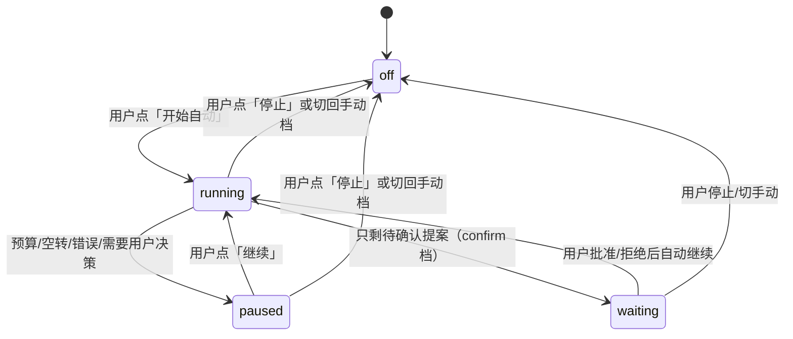

# 02 · Agent 设计与编排

> 五类 Agent 的分工：**worker** 执行节点、**advisor（专家组）** 生长 DAG、**scheduler（调度器）** 分配资源、
> **GC（善后）** 在确定性终止后做 postmortem/清理请求、**controller** 作为项目级 parent；此外每个节点还有一个
> 不作为 LLM 角色的 **node anchor**（root Agent，cwd=worktree），它只解决 sandbox 边界与 `sendMessage` sender 问题
> （见 01 §7.3）。所有任务型 Agent 都通过 DSH 的 subagent 机制以「一次性激活 + 结构化输出」运行。

---

## 1. 角色总览

| 角色 | preset id | 何时创建 | 生命周期 | 工具 | 输出 |
|---|---|---|---|---|---|
| **worker** | `lab-worker` | 节点被调度启动 / 用户继续对话 | 每次 activation 一轮任务；完成后 dispose；后续对话冷恢复 | coding 工具（bash/fs/fs-search/todo/web）+ compaction；**无**委派、无 ask-user | 首次：`NodeReport`（structured_output）；follow-up：纯文本 |
| **advisor** | `lab-advisor` | 每个 cycle 的 advisor pass | 一次性 spawn，读完结果即 dispose | 无文件/命令工具（快照已提供信息），只有自动注入的 `structured_output` | `AdvisorOutput` |
| **scheduler** | `lab-scheduler` | 每个 cycle 的 scheduler pass | 一次性 spawn，读完结果即 dispose | 无工具，只有 `structured_output` | `SchedulerOutput` |
| **controller** | `lab-controller` | 项目创建时创建 root 会话，按需 resume | 项目生命周期 | 无 | 不产生任务输出；项目级 parent（advisor/scheduler 的 parent，冷恢复 sender） |
| **GC 善后** | `lab-gc` | 节点被确定性终止后（timeout/cancel/异常清理） | 一次性 spawn，异步、不阻塞资源释放 | 只读 fs + `lab_cleanup`（Host 确定性清理工具，仅 GC 可见） | `GCOutput`（postmortem） |
| **node anchor**（非 LLM 角色） | `lab-controller` | 节点启动时创建 root 会话，按需 resume | 节点生命周期（封存/dispose） | 无 | 不调用 LLM；作为 worker 的 parent 与继续对话 sender；提供 `header.cwd=worktree` 的 sandbox 边界 |

设计要点：

- **模型**：preset 不能声明模型（DSH 的 preset 只组合 plugin 行），所以每个角色的模型在 activation 时通过
  `request.agentOptions = { provider, model, reasoningEffort }` 传入；项目配置缺省时用
  `ctx.agentDefaultModel.currentSelection()`。
- **advisor / scheduler 为什么用一次性激活而不是常驻会话**：两者都是「输入快照 → 输出决策」的无状态函数，
  一次性激活天然隔离上下文、可用 `outputSchema` 强制结构化、失败即丢弃；不会随迭代轮数累积 token。
- **controller 与 node anchor 为什么必须存在**：`ctx.subagents.startActivation` 要求一个 live `Agent` 作为 `parent`；
  后续 `sendMessage` 也要求 live `Agent` 作为 sender，且只允许相邻 parent↔child。Host 插件本身不是 Agent，
  而 DSH 的 sandbox 边界取 parent 会话的 `header.cwd`，所以需要两层：
  项目 controller（cwd=repoRoot，advisor/scheduler 的 parent）与每节点 node anchor（cwd=worktree，worker 的 parent）。
  anchor 不调用 LLM，只占一个空会话（`origin:'subagent'`，DSH 侧栏不显示）。

---

## 2. 四个 Preset（bundle patch 内声明）

放在独立的 `presets.patch.yml` 里，由 `package.json` 的 `dsh.bundle.patch` 数组引用：

```json
{ "dsh": { "bundle": { "patch": ["./cordis.patch.yml", "./presets.patch.yml"] } } }
```

> 依据：`dsh.bundle.patch` 支持字符串或字符串数组，`@deepseek-ai/dsh-web-app` 就是用数组把
> `presets/standard.patch.yml` 等 4 个 preset 文件一起加进 profile 的（见其 `package.json` 的 `dsh.bundle.patch`）。
> preset 的 plugin 行引用的是 DSH 自带的包（persona/tool-*/compaction），本地 bundle 无需声明这些依赖。

它们会出现在 Agent preset 选择器里，描述写成「由 MetaInfer Research Lab 自动使用」，
`order` 设高值排在后面。**下面 2.1 / 2.2 的条目最终合并进同一个 `insert:` 列表（同一个 `presets.patch.yml`）。**

### 2.1 `lab-worker`

```yaml
- insert:
    - id: preset-lab-worker
      name: '@deepseek-ai/dsh-agent-preset'
      config:
        id: lab-worker
        name: MetaInfer Research Lab Worker
        description: 由 MetaInfer Research Lab 自动创建：执行单个实验节点，请勿手工选择。
        order: 90
        plugins:
          - id: persona
            name: '@deepseek-ai/dsh-persona'
            config:
              prefix: |
                You are the experiment-execution agent of MetaInfer Research Lab. You execute exactly one
                experiment node inside an isolated git worktree, then stop. You do not plan the
                research roadmap, you do not start other experiments, and you never ask the user
                questions. Your final action must be calling structured_output with the report.
              suffix: ''
          - id: agent-instructions        # 读取 worktree 里的 AGENTS.md，遵守仓库约定
            name: '@deepseek-ai/dsh-agent-instructions'
            config: { maxBytes: 65536 }
          - id: time-context
            name: '@deepseek-ai/dsh-time-context'
          - id: tool-bash
            name: '@deepseek-ai/dsh-tool-bash'
            disabled: !!js process.platform === 'win32'
          - id: tool-pwsh
            name: '@deepseek-ai/dsh-tool-pwsh'
            disabled: !!js process.platform !== 'win32'
          - id: tool-fs
            name: '@deepseek-ai/dsh-tool-fs'
          - id: tool-fs-search
            name: '@deepseek-ai/dsh-tool-fs-search'
            config: { sampleOverCapGlobResults: false }
          - id: tool-todo
            name: '@deepseek-ai/dsh-tool-todo'
          - id: tool-web                    # 科研实验常需要查资料；可按项目配置关闭（v2）
            name: '@deepseek-ai/dsh-tool-web'
            config: { fetch: true, searchTimeoutMs: 60000 }
          - id: compaction
            name: cordis:group
            group: true
            isolate: { compaction: true, toolResultPruner: true }   # 与 shipped standard preset 一致
            config:
              - id: compaction-basic
                name: '@deepseek-ai/dsh-compaction-basic'
              - id: tool-result-pruner
                name: '@deepseek-ai/dsh-compaction-tool-result-pruner'
                config: { thresholdChars: 8192, headChars: 4096, tailChars: 1024 }
```

**刻意不包含**：delegation 组（`subagent`/`subagent_fork`/`workflow`）、`ask_user_question`、plan-mode、goal/schedule/jobs/skill/present。
递归委派由「preset 里没有任何 delegation 工具行」阻止即可；**不要给 activation 传 `maxDepth`**——
子级 depth 恒等于 parent depth+1，传 `0` 会让每次 activation 直接抛 `SubagentDepthError`（`dsh-subagent/lib/index.js` 的 `resolveChildDepth`）。
`structured_output` 由 DSH 的 subagent 层自动挂到子会话（`dsh-subagent/lib/types/structured.d.ts`），不需要在 preset 里声明。

### 2.2 `lab-advisor` / `lab-scheduler` / `lab-controller`

```yaml
- insert:
    - id: preset-lab-advisor
      name: '@deepseek-ai/dsh-agent-preset'
      config:
        id: lab-advisor
        name: MetaInfer Research Lab Advisor
        description: 由 MetaInfer Research Lab 自动创建：审阅实验结果并提议后继节点，请勿手工选择。
        order: 91
        plugins:
          - id: persona
            name: '@deepseek-ai/dsh-persona'
            config:
              prefix: |
                You are the review board (advisor) of MetaInfer Research Lab. You never write code and
                never run experiments. You read a snapshot of the experiment DAG, judge the
                results, and submit zero to three successor experiment nodes. Your entire answer
                is submitted through structured_output.
              suffix: ''
              includeRuntimeContext: false

    - id: preset-lab-scheduler
      name: '@deepseek-ai/dsh-agent-preset'
      config:
        id: lab-scheduler
        name: MetaInfer Research Lab Scheduler
        description: 由 MetaInfer Research Lab 自动创建：在资源约束下决定启动哪些待执行节点，请勿手工选择。
        order: 92
        plugins:
          - id: persona
            name: '@deepseek-ai/dsh-persona'
            config:
              prefix: |
                You are the resource scheduler of MetaInfer Research Lab. You never write code and never
                run experiments. Given the resource pools and the current DAG state, you choose
                which planned nodes may start now. Your entire answer is submitted through
                structured_output.
              suffix: ''
              includeRuntimeContext: false

    - id: preset-lab-controller
      name: '@deepseek-ai/dsh-agent-preset'
      config:
        id: lab-controller
        name: MetaInfer Research Lab Controller
        description: 每个 MetaInfer Research Lab 项目的控制器会话；不直接执行任务。
        order: 93
        plugins:
          - id: persona
            name: '@deepseek-ai/dsh-persona'
            config:
              prefix: |
                This session is the controller root of a MetaInfer Research Lab project. It only hosts the
                project's experiment sub-sessions; it does not execute experiments itself. Use the
                MetaInfer Research Lab panel in the sidebar to drive the project.
              suffix: ''
              complete: true
              includeRuntimeContext: false

    - id: preset-lab-gc
      name: '@deepseek-ai/dsh-agent-preset'
      config:
        id: lab-gc
        name: MetaInfer Research Lab GC
        description: 由 MetaInfer Research Lab 自动创建：确定性终止后的善后与复盘，请勿手工选择。
        order: 94
        plugins:
          - id: persona
            name: '@deepseek-ai/dsh-persona'
            config:
              prefix: |
                You are the post-mortem and cleanup agent (GC) of MetaInfer Research Lab. A node's
                deterministic watchdog has already killed its agent tree and OS processes; your job
                is to explain what happened, verify leftovers, request deterministic cleanup if
                needed, and produce a concise postmortem. You never decide whether to kill anything:
                the Host does that deterministically. You may only request cleanup through the
                lab_cleanup tool, which the Host executes as code.
              suffix: ''
              includeRuntimeContext: false
          - id: tool-fs
            name: '@deepseek-ai/dsh-tool-fs'
            config: { write: false, edit: false }
          - id: tool-fs-search
            name: '@deepseek-ai/dsh-tool-fs-search'
```

> 注意：**不要给 `lab-worker` 用 `complete: true`**。`complete: true` 会让 persona 成为唯一 prompt section，
> 连工具使用说明和结构化输出说明都会被抑制。advisor/scheduler 没有工具（除了自动注入的 `structured_output`），
> 用 `includeRuntimeContext: false` 减少噪声即可，也不建议开 `complete`（会压制 structured_output 的提示）。

---

## 3. 提示词

### 3.1 worker：激活提示词模板（Host 组装，节点 prompt 是其中一段）

```text
# Project
Name: {project.name}
Research goal / brief:
{project.brief}

# Your node
Node: {node.id} — {node.title}
Parent node: {parentTitle or "project base"}
Base commit: {node.git.baseCommit}
Working directory: {node.git.worktreePath}   (this is your git worktree; work only inside it)

# Task (the experiment to perform)
{node.prompt}

# Success criteria
{successCriteria or "The task's code/data/artifacts are written into the working directory and are reproducible."}

# Context from ancestor experiments (read-only reference)
{ancestor summaries: title, report.summary, key metrics, commit, ≤600 chars each}

# Constraints
- Resources requested for this node: {needs as "gpu=1" or "none"}. Do not launch work beyond these.
- Time box: {timeboxMinutes} minutes (`{timeboxMs}` ms). This is a HARD deadline enforced by the
  lab's deterministic watchdog: when it fires, your agent tree and processes are killed, so plan to
  finish well within it and submit the report early rather than risk being cut off. If the task
  clearly cannot finish in time, do the smallest useful slice and report it.
- Do NOT run git write commands (commit/checkout/branch/tag/worktree/push). Versioning is
  handled automatically by the lab after your turn.
- Do NOT delegate to sub-agents or ask the user anything; delegation is disabled and questions
  will not be answered.
- Operations requiring approval are rejected automatically; if you hit one, record it in blockers
  and finish the rest of the task.
- Do exactly this node. Ideas for follow-up experiments go into `next`, not into this run.

# Finish
Call structured_output exactly once with the report schema. After that your run ends.
```

> **仅首次激活要求 `structured_output`**。用户后续「继续对话」走的是冷恢复的同一会话，
> 冷恢复不会重新挂 `structured_output`（descriptor 不含它），所以 follow-up 消息模板**不要**要求调用结构化工具，
> 而是让 worker 用文本总结；Host 用最后一条 assistant 消息更新 `reportText`/`followUps`（见 §4.2）。

**follow-up 消息模板（继续对话时由 Host 拼装）**：

```text
Additional instruction for node {node.id} "{title}":
{userText}

Work only inside the current worktree, do not run git write commands, and finish with a short
plain-text summary of what changed and what you observed. Do not call structured_output.
```

### 3.2 worker 的报告 schema（`outputSchema`）

```json
{
  "type": "object",
  "properties": {
    "summary":      { "type": "string", "description": "3-6 sentences: what you did and what you concluded." },
    "changes":      { "type": "array", "items": { "type": "string" }, "description": "Files/directories created or modified." },
    "metrics":      { "type": "array", "items": {
                        "type": "object",
                        "properties": {
                          "name":  { "type": "string" },
                          "value": { "type": "string" },
                          "unit":  { "type": "string" }
                        },
                        "required": ["name", "value"],
                        "additionalProperties": false } },
    "reproduce":    { "type": "array", "items": { "type": "string" }, "description": "Exact commands to reproduce." },
    "success":      { "type": "boolean" },
    "blockers":     { "type": "array", "items": { "type": "string" } },
    "next":         { "type": "array", "items": { "type": "string" }, "description": "0-3 suggested follow-up experiments." },
    "risks":        { "type": "array", "items": { "type": "string" } }
  },
  "required": ["summary", "changes", "metrics", "reproduce", "success", "blockers", "next", "risks"],
  "additionalProperties": false
}
```

> schema 必须落在 DSH 的 `assertObjectJsonSchema` 支持子集内（见 §3.3 末尾注释）；本 schema 只使用
> `type/properties/required/items/additionalProperties:false/description`，合法。
> `outputSchema` 在 `startActivation` 时校验，不合法会直接抛 `UNSUPPORTED_SCHEMA`，不会静默降级。

Host 兜底：若 `structured` 缺失但 `stopReason==='completed'`，用最后一条 assistant 文本作为 `reportText`，
节点标 `completed` 但 `report=null`（UI 提示「报告未结构化」）；advisor 快照里用 `reportText` 代替。

### 3.3 advisor：激活提示词模板

```text
# Role
You are the review board of MetaInfer Research Lab. Read the snapshot below and decide the next
experiment steps. You cannot run anything; your proposals are validated and executed by the lab.

# Rules
1. Only propose successors for parents in `candidateParents` (id present). A parent must be a
   completed experiment; branching from an earlier ancestor is allowed (it creates a new
   experiment branch from that frozen commit).
2. At most {maxProposals} proposals. Prefer 1; propose 2-3 only when they are genuinely
   informative alternatives (different hypotheses, not duplicates).
3. Each proposal must be self-contained: a fresh execution agent with no prior context must be
   able to do it from `prompt` + the project brief + ancestor summaries.
4. `needs` is an array of `{key, amount}` objects; `key` must be a resource key listed in
   `resources.pools`, and no node may exceed the pool size. Omit `needs` (or use `[]`) when the
   node needs no special resource.
5. Do not duplicate an existing node or a recent proposal (see `recentProposals`).
6. If the results are inconclusive and need a human decision, set `needUserDecision: true` and
   explain in `note`; you may still return proposals.
7. If no further experiments are worthwhile, return `proposals: []` and explain why.
8. Your entire answer must be submitted via structured_output.
9. A node may be in `failed` with `error.stage='timeout'`: the deterministic watchdog killed it.
   Treat this as information (scope too large / wrong approach / resource contention). You may
   propose a successor on the same parent (e.g. split into smaller nodes, or retry with a larger
   `timeboxMinutes` when justified), or abandon that branch. Never propose "run longer" without a
   concrete reason.

# Snapshot
{snapshot JSON}
```

**advisor 快照**（Host 构造，截断后注入）：

```jsonc
{
  "project": { "name": "...", "brief": "..." },
  "budget": { "nodesUsed": 7, "maxNodes": 60, "cyclesRun": 12 },
  "candidateParents": [
    { "id": "n-0007", "title": "...", "kind": "leaf", "headCommit": "3f2a1b0",
      "prompt": "…≤800字", "report": { "summary": "…≤600字", "metrics": ["val_loss=0.84"],
        "success": true, "next": ["…"] },
      "needs": { "gpu": 1 }, "children": 0, "reviewedHeadCommit": null },
    { "id": "n-0005", "title": "...", "kind": "ancestor", "headCommit": "…", "report": {…} }
  ],
  "running": [ { "id": "n-0008", "title": "...", "elapsedMs": 360000, "needs": { "gpu": 1 } } ],
  "failed":  [ { "id": "n-0006", "title": "...", "error": "…", "errorStage": "timeout",
                 "timeboxMinutes": 10, "termination": { "killedPids": [1234], "gpuFreed": true,
                 "verifiedClean": true, "postmortem": "…≤400字" } } ],
  "resources": { "pools": { "gpu": 2 }, "free": { "gpu": 1 }, "maxRunningNodes": 4 },
  "pendingProposals": [
    { "parentId": "n-0007", "nodeId": "n-0012", "title": "...", "promptHash": "…",
      "createdAt": 0, "ageMs": 3600000 }
  ],
  "recentProposals": [ { "parentId": "n-0007", "title": "...", "promptHash": "…" } ]
}
```

Host 构造快照时把「已有待确认提案的叶子」从 `candidateParents` 的 leaf 中排除，
并在 `pendingProposals` 中列出，提示 advisor 不要重复提案（人工可能很晚才处理）。

**advisor 输出 schema**：

```json
{
  "type": "object",
  "properties": {
    "analysis": { "type": "string", "description": "Assessment of the current experimental state." },
    "proposals": { "type": "array", "items": {
      "type": "object",
      "properties": {
        "parentId":        { "type": "string" },
        "title":           { "type": "string" },
        "prompt":          { "type": "string" },
        "needs":           { "type": "array", "items": {
                             "type": "object",
                             "properties": {
                               "key":    { "type": "string" },
                               "amount": { "type": "integer" }
                             },
                             "required": ["key", "amount"],
                             "additionalProperties": false } },
        "successCriteria": { "type": "string" },
        "timeboxMinutes":  { "type": "integer", "description": "Hard execution deadline for the new node; default 10, max from project config." },
        "rationale":       { "type": "string" },
        "expectedInfoGain":{ "type": "string" }
      },
      "required": ["parentId", "title", "prompt", "rationale"],
      "additionalProperties": false } },
    "needUserDecision": { "type": "boolean" },
    "note": { "type": "string" }
  },
  "required": ["analysis", "proposals", "needUserDecision"],
  "additionalProperties": false
}
```

> **schema 子集约束**：`outputSchema` 会先过 DSH 的 `assertObjectJsonSchema`，只接受
> `type/properties/required/additionalProperties/items/enum/const/oneOf` + 注解 `description/title/default/examples`；
> `additionalProperties` 必须是**布尔值**，不能是 schema 对象（这就是 `needs` 用数组而不是 map 的原因）。
> 违反会在 `startActivation` 时直接抛 `UNSUPPORTED_SCHEMA`。

### 3.4 scheduler：激活提示词模板

```text
# Role
You are the resource scheduler of MetaInfer Research Lab. Decide which planned nodes may start now.
You cannot create or modify nodes; the lab enforces the resource limits after your answer.

# Rules
1. Only choose nodeIds from `planned`. Never choose running/completed/failed nodes.
2. The sum of chosen `needs` plus `resources.held` must stay within `resources.pools`;
   the number of running plus chosen nodes must not exceed `maxRunningNodes`.
3. Array order is priority. Prefer experiments that are cheap, high-information, or unblock
   later work; with a scarce resource, prefer the highest-value node.
4. It is valid to start nothing (`starts: []`), e.g. when planned nodes are low value or the
   scheduler wants to wait for a running result.
5. Your entire answer must be submitted via structured_output.

# Snapshot
{snapshot JSON}
```

**scheduler 快照**：

```jsonc
{
  "project": { "name": "...", "brief": "..." },
  "resources": {
    "pools": { "gpu": 2 }, "held": { "gpu": 1 }, "free": { "gpu": 1 },
    "maxRunningNodes": 4, "runningCount": 1
  },
  "running": [ { "id": "n-0008", "title": "...", "needs": { "gpu": 1 }, "elapsedMs": 360000 } ],
  "planned": [ { "id": "n-0009", "title": "...", "promptExcerpt": "…≤400字",
                 "needs": { "gpu": 1 }, "parentTitle": "...", "createdAt": 0 } ]
}
```

**scheduler 输出 schema**：

```json
{
  "type": "object",
  "properties": {
    "analysis": { "type": "string" },
    "starts": { "type": "array", "items": {
      "type": "object",
      "properties": {
        "nodeId": { "type": "string" },
        "reason": { "type": "string" }
      },
      "required": ["nodeId", "reason"],
      "additionalProperties": false } },
    "note": { "type": "string" }
  },
  "required": ["analysis", "starts"],
  "additionalProperties": false
}
```

### 3.5 GC（善后）Agent：`lab-gc`

**触发**：节点被确定性终止后（超时 / 取消 / 异常）由 Host **异步** spawn，不阻塞资源释放与后续 cycle。
**输入**：节点信息、`timeboxMs`、`termination` 记录（killedPids/killedJobs/gpuFreed/verifiedClean/leftover）、
reaper 报告、worker 最后几条对话/日志摘要、项目与父节点摘要。
**工具**：只读 fs（read/glob/grep）+ `lab_cleanup`（Host 实现的确定性清理工具；GC 只能触发，不直接执行 kill）。
**约束**：GC 不能决定「是否杀、何时杀」；不能修改节点状态；失败/超时不重试、不阻塞任何流程。
**实现**：GC 由 controller 作为 parent（cwd=repoRoot）一次性 spawn；Host 在 `agent/created` 里按预分配的 childId
把 `lab_cleanup` 工具注册到该 GC 子会话的 agent scope（其他角色看不到这个工具）。

```text
# Role
You are the GC agent of MetaInfer Research Lab. The deterministic watchdog has already killed the
node "{nodeId}" at its deadline ({timeboxMinutes} min). You cannot see or control the live processes.
Read the post-termination report below, inspect the worktree read-only, and produce a postmortem.

# Rules
1. Explain the likely cause: task too large, wrong approach, resource contention, tool hang, or an
   environment issue (use the reaper report: killed PIDs, jobs, GPU state).
2. Verify leftovers from the report. If something is still leaked, call lab_cleanup with the exact
   target; the Host executes the cleanup deterministically and returns the resulting state.
3. Recommend one of: retry / split_into_smaller_nodes / extend_timebox / abandon_branch / none.
4. Keep it short and factual; do not speculate beyond evidence.
5. Submit your answer via structured_output.
```

**GC 输出 schema**：

```json
{
  "type": "object",
  "properties": {
    "cause": { "type": "string" },
    "leftovers": { "type": "array", "items": { "type": "string" } },
    "cleanupRequested": { "type": "boolean" },
    "recommendation": { "type": "string",
      "enum": ["retry", "split_into_smaller_nodes", "extend_timebox", "abandon_branch", "none"] },
    "summary": { "type": "string" }
  },
  "required": ["cause", "leftovers", "cleanupRequested", "recommendation", "summary"],
  "additionalProperties": false
}
```

GC 的 postmortem 会写进 `node.termination.gcRunId` 对应 run，并在下一轮 advisor 快照里作为
`failed[].termination.postmortem` 出现；**它只影响专家组的决策输入，不影响资源账本与终止结果**。

---

## 4. 调用方式（Host 侧伪代码）

### 4.1 controller / node anchor / 角色激活

```ts
// 1) 项目创建时：project controller（root，cwd=repoRoot，advisor/scheduler 的 parent）
const controllerSessionId = `session-${randomUUID()}`;    // SessionId 是编译期 brand，运行时就是字符串
const controller = await ctx.agents.create({
  sessionId: controllerSessionId as SessionId,
  meta: { cwd: project.repo.path, origin: 'subagent', agentPreset: 'lab-controller' },
  agentOptions: ctx.agentDefaultModel.currentSelection(),  // controller 不执行任务，用部署默认模型即可
  setup: async (agentCtx) => { await ctx.agentPresets.mount(agentCtx, 'lab-controller'); },
});

// 2) 节点启动时：node anchor（root，cwd=worktree，worker 的 parent；不调用 LLM）
const anchorSessionId = node.anchorSessionId;             // 节点创建时预分配并持久化
const anchor = await ctx.agents.create({
  sessionId: anchorSessionId as SessionId,
  meta: { cwd: node.git.worktreePath, origin: 'subagent', agentPreset: 'lab-controller' },
  agentOptions: ctx.agentDefaultModel.currentSelection(),
  setup: async (agentCtx) => { await ctx.agentPresets.mount(agentCtx, 'lab-controller'); },
});

// 3) 角色激活（worker / advisor / scheduler 共用）
const activation = await ctx.subagents.startActivation({
  provider: 'spawn',
  label: `${project.id}/${node.id}`,                      // 或 `advisor@cycle-123`
  delivery: 'caller',                                     // caller：结果由调用方 await，不推 settlement
  signal: runtime.lifetime.signal,
  childId: node.sessionId as SessionId,                   // 预分配；崩溃恢复时知道该读哪个会话
  request: {
    parent: role === 'worker' ? anchor.agent : controller.agent,
    cwd: role === 'worker' ? node.git.worktreePath : project.repo.path,
    prompt: [{ type: 'text', text: composedPrompt }],
    agentPreset: rolePreset,                              // 'lab-worker' | 'lab-advisor' | 'lab-scheduler'
    agentOptions: roleModel(role),
    outputSchema: roleSchema,                             // worker=NodeReport; advisor/scheduler=决策
    // 不传 maxDepth
  },
});
// sandbox 边界断言：header.cwd 必须等于 worktree（不是 workingDirectory 投影）
if (role === 'worker') {
  const child = ctx.agents.get(activation.childId as SessionId);
  if (child?.session.header.cwd !== node.git.worktreePath) throw new Error('sandbox boundary mismatch');
}
const result = await activation.result;                   // { output, structured?, diagnostic?, stopReason }
// NodeRunner 在激活成功后 arm watchdog：deadline = now + node.timeboxMs（默认 10min）
// 软提醒/硬终止全部由 Host 代码执行，见 01 §9.1 与本文 §5.4
await activation.dispose();                               // 释放 activation 名额
```

### 4.2 继续对话（仅未封存叶子）

```ts
// 确保 node anchor 存活（插件重启后 agents.resume；anchor session id 已持久化）
const anchor = await ensureAnchorLive(project, node);     // 冷恢复：agents.resume({ resumeSessionId: node.anchorSessionId })

const content = [{ type: 'text', text: composeFollowUpPrompt(node, userText) }];
await ctx.subagents.sendMessage(anchor.agent, node.sessionId as SessionId, content, { signal });
// 完成信号：监听该 session 的 durable turn/end，且 reason.kind === 'completed'
// 冷恢复的 follow-up 没有 structured_output：报告用最后 assistant 文本（reportText），
// 节点仍按「commit → 更新 headCommit/reportText/followUps → completed」处理。
```

`sendMessage` 只允许相邻 parent↔child；冷/驻留子会话都可以。**不要**试图让 Host 插件直接调用 `agent.followup`
（拿不到子 Agent 的稳定句柄；subagent 服务会在冷恢复时重建并保留 cwd/preset/toolFilter）。
anchor 会话不执行任何 LLM 对话，只是给 worker 提供「cwd=worktree 的 parent」与「继续对话的 sender」。

---

## 5. 编排循环（Cycle）

### 5.1 手动 Step

```
Step 点击
  └─ POST /api/metainfer-research-lab/commands {type:'project.step', projectId}
       └─ Orchestrator.runCycle('manual')
            1. reconcile()                # 兜底：核对 running 节点的 session 状态
            2. advisor pass（手动档总是尝试，除非没有任何 completed 节点）
                 candidates = 活跃叶子 ∪ 其 k 级祖先（k=advisor.ancestorDepth）
            3. scheduler pass（有 planned 节点时）
            4. 写 CycleRecord + 事件，返回 {cycleId, created, started, skipped, errors}
```

- 手动档**不受**自动预算（maxCycles/maxWallClock）限制；但 `maxNodes` 与资源上限仍然硬校验。
- 手动档 Step 不可重入：若 cycle 正在进行，返回 `{busy:true}`，UI 显示「正在推进…」。
- Step 的 advisor 即使没有「新结果」也会运行（用户显式要求评审），候选集退化为最近 completed 节点。

### 5.2 自动挡



> **`waiting` 不是阻塞**：已经 planned/running 的节点继续执行，调度器照常工作；
> 只是没有新的可评审对象时不再空转 cycle，等人工处理 pendingProposals 后再继续。

触发源：

| 触发 | 动作 |
|---|---|
| 切入自动挡 | 立即跑一个 cycle（trigger=`auto-start`） |
| worker 完成/失败（外部事件） | debounce `auto.debounceMs`（默认 1.5s）后跑 cycle |
| 用户命令（启动/取消/继续对话） | debounce 后跑 cycle |
| 定时兜底 | 每 30s 跑一次 cycle（主要用于「资源释放后重试启动」） |
| 用户手动 Step | 自动挡下隐藏 Step（避免双入口） |

**防自激**：cycle 自己产生的 mutation（advisor 创建节点、scheduler 启动节点）**不**触发下一轮；
所有事件带 `cycleId`（外部事件为 null），自动循环只对 `cycleId === null` 的事件置 dirty。
cycle 结束时显式调用 `maybeScheduleNext()`：若还有 planned 节点且资源有余量、或还有未评审叶子，则立刻排下一轮；
否则等待外部事件/兜底定时器。这样既不会漏推进，也不会「自己触发自己」空转。

每个 cycle：

```
1. reconcile()
2. if (存在 actionable leaves) and (未到 advisor 冷却) and (预算允许):
       run advisor → 校验 → acceptMode='auto'：创建 planned + 封存父节点
                              acceptMode='confirm'：创建 proposed（不封存父节点），等人工
3. if (存在 planned 节点) and (资源有余量):
       run scheduler → 校验 → 启动节点（受资源/并发硬校验；proposed 不参与）
4. 更新计数；检查暂停条件 / waitingConfirmation
5. 若仍有 running 节点 → 等下一轮事件（节点完成会用新结果触发下一次 advisor）
```

**人工确认档的自动挡行为**：
- 有 running/planned 节点时，自动挡照常跑 cycle；待确认提案只占「待确认」列表；
- 当 `actionableLeaves` 为空、planned 为空、running 为空、但 `pendingProposals > 0` 时，进入 `waiting` 状态（不是 paused，不算 noProgress）；
- 用户批准/拒绝任意提案后，Host 直接 `maybeScheduleNext()` 恢复推进；
- 若 `pendingProposals` 数超过 `advisor.maxPendingProposals`（配置项，默认 20），advisor pass 跳过并提示人工清理，避免无限堆积。

暂停条件（写入 `auto.pauseReason`，UI 显示具体原因和「继续」按钮）：

| reason | 条件 |
|---|---|
| `maxCycles` | 自动 cycle 数 ≥ `auto.maxCycles`（默认 50） |
| `maxWallClock` | 从自动启动起 ≥ `auto.maxWallClockMs`（默认 6h） |
| `maxNodes` | 项目节点数 ≥ `config.maxNodes`（默认 60） |
| `noProgress` | 连续 `auto.idleCycleLimit`（默认 3）个 cycle 既没创建也没启动节点 |
| `idle` | 没有 planned、没有 running、没有 actionable leaf（无事可做） |
| `needUserDecision` | advisor 明确返回 `needUserDecision: true` |
| `errors` | 连续 3 个 cycle 出现 advisor/scheduler 运行失败 |
| `hostRestarted` | 插件加载时 `project.mode==='auto'` 但运行时不存在（安全默认：不自动恢复） |

**崩溃/重启语义**：自动挡运行状态只存内存；插件重启后自动挡一律进入 `paused`（reason=`hostRestarted`），
用户点「继续」才恢复。这是防止「重启后无人值守烧钱」的关键安全阀。

**漏触发兜底**：cycle 执行期间若有节点完成/状态变化，设置 `pendingCycle = true`；当前 cycle 结束后立即补跑一轮。
定时兜底（30s）也覆盖「资源释放后本应启动但错过事件」的情况。

### 5.3 每个 cycle 的锁与事务边界

LLM 调用可能持续数十秒到数分钟，**不能在持锁期间调用**。采用三段式：

1. **准备（持锁）**：读取状态、构造快照、记录 run 开始、释放锁。
2. **等待（不持锁）**：await advisor/scheduler activation result。
3. **落地（持锁）**：重新校验候选集 → 执行创建/启动；失败则记录拒绝原因。

用户操作（取消节点、改提示词、切模式）在阶段 2 可以正常进行；阶段 3 的校验会把过期提案安全拒绝。

### 5.4 节点超时：确定性终止 → Reaper → GC

超时路径完全由 Host 代码执行，**不调用任何 Agent 决定是否 kill**（详见 01 §9.1）：

```
deadline 到（Watchdog 每秒墙钟扫描；不是只靠 setTimeout）
  → phase='terminating'，写 termination.requestedAt / 事件 node/terminating
  → [确定性终止序列，全部 bounded]
       1) childAgent.cancel({kind:'parent'}) + activation.dispose() + subagents.interrupt/drainChildren
       2) ctx.jobs.list(sessionId) → ctx.jobs.kill(...)（清掉 bash 超时转后台的 job）
       3) 扫描 /proc/<pid>/cwd 落在 node.worktreePath 下的 PID → SIGTERM → SIGKILL → 验证 ESRCH
       4) nvidia-smi 查询：确认无本节点 PID 占用显存
       5) finally：释放 resourcesHeld；尽力 commit 部分改动；dispose anchor
       6) 验证：verifiedClean = 无进程/job/GPU 残留且资源已释放；不通过 → needsAttention + 暂停自动挡
  → node.status='failed'，error.stage='timeout'，termination 记录完整
  → 通知自动循环 / advisor（节点进入 failed 列表）
  → 异步 spawn lab-gc（不阻塞）：postmortem + leftover 解释 + lab_cleanup（如需）
  → 下一轮 advisor 看到 timeout 信息与 postmortem，决定拆小任务/延长时限/换路/放弃分支
```

**软提醒**：deadline 前 `(1 - timeoutWarningRatio)` 时（默认剩余 20%），Host 向 worker 会话 steer 一条
「时间预算还剩 X，收尾并提交报告」；它只是提示，到点仍然硬杀。
**每节点 timebox**：`node.timeboxMs` 默认 10min，advisor 提案可带 `timeboxMinutes`，用户创建/批准/编辑节点时可改，
上限 `maxNodeTimeoutMs`（默认 4h）；重试重置 deadline。
**自动挡**：节点因超时 failed 不会暂停自动挡；是否继续该方向由 advisor 决定（这正是「用超时作为信息」的设计）。

---

## 6. Host 侧校验规则（Agent 输出 → 状态变更）

### 6.1 advisor 输出校验

| 顺序 | 校验 | 失败处理 |
|---|---|---|
| 1 | `stopReason === 'completed'` 且 `structured` 存在且符合 schema | 整个 run 记 failed，写 error；cycle 继续进入 scheduler |
| 2 | `proposals.length ≤ config.advisor.maxProposalsPerPass` | 超出部分记 rejected，保留前 N 个 |
| 3 | `parentId ∈ candidateParents` 且父节点 `status=completed` 且有 `headCommit` | 该条 rejected |
| 4 | `title` 非空 ≤ 80 字；`prompt` 20..8000 字 | 该条 rejected |
| 5 | `needs` 数组元素：`key` ∈ `resourcePools`、`amount` 为非负整数、单节点合计 ≤ 池容量 | 该条 rejected |
| 5b | `timeboxMinutes` 为整数且 ∈ `[1, maxNodeTimeoutMs/60000]`；省略时取 `nodeTimeoutMs`（默认 10） | 该条 rejected |
| 6 | 来自 ancestor（非活跃叶子）的提案每个 cycle 最多 1 个（避免在旧节点上无限分叉） | 超出部分 rejected |
| 7 | 去重：`(parentId, normalize(prompt) 的哈希)` 不等于任何已有节点/最近提案 | 该条 rejected |
| 8 | 节点数未超 `maxNodes` | 该条 rejected；若已满，暂停自动挡 |
| 9 | 全部通过后按顺序落地：`acceptMode='auto'` → **commit 父节点残留改动 → 写 planned 子节点 → 封存父节点（tag + sealedAt）**；`acceptMode='confirm'` → **只写 proposed 子节点（预分配 anchor/worker 会话 id），不 commit/tag/封存父节点** | 封存失败 → 记录 `git/error` 并留给 reconcile 补做；子节点保留 |

每条 proposal 落地后写 `LabEvent(node/created)`（confirm 档额外写 `node/proposed`），并给父节点写 `review`。
即使本轮 advisor 一个提案都没通过，也要给所有被评审的活跃叶子写 `review.decision='none'`（避免自动挡反复重评同一版本）。

### 6.1.1 人工确认档：批准 / 拒绝 / 编辑后批准

| 动作 | Host 校验 | 副作用（按顺序） |
|---|---|---|
| **批准** `node.approve` | 节点是 `proposed`；父节点仍 `completed` 且未在 running；资源键合法 | ① commit 父节点当前残留改动，取当前 `headCommit`；若与提案时不同 → 更新子节点 `baseCommit` 并在事件/UI 标注「基线已更新」；② 节点 `status='planned'`、`approvedAt=now`、清空 `proposal`；③ 若父节点首次有已批准子节点 → 封存父节点（tag + sealedAt + 释放 anchor）；④ 事件 `node/approved`；⑤ `maybeScheduleNext()` |
| **拒绝** `node.reject` | 节点是 `proposed` | 删除该节点记录（没有 worktree/session，无 Git 副作用）；父节点保持未封存；事件 `node/rejected`；`maybeScheduleNext()` |
| **编辑后批准** | 同批准；先应用 `title/prompt/needs/successCriteria/timeboxMinutes` 的编辑 | 同批准（编辑先写库再走批准；timebox 会校验在 `[1, maxNodeTimeoutMs/60000]` 内） |
| **批量批准**（可选，v1.1） | 逐条按批准规则校验 | 逐条落地；失败项单独提示 |

批准后节点进入 `planned`，由下一次 scheduler pass 正常参与资源竞争；**批准本身不绕过资源校验**。
审批期间父节点若被用户继续对话（headCommit 变化），以批准时的新 headCommit 作为子节点基线（研究语义：从最新结果分支）。

### 6.2 scheduler 输出校验

| 顺序 | 校验 | 失败处理 |
|---|---|---|
| 1 | schema 合法 | run failed |
| 2 | 每个 `nodeId` 是当前项目 `planned` 节点，去重 | rejected |
| 3 | 按数组顺序依次尝试启动，每次检查：资源账本（`free ∓ needs ≥ 0`）、`runningCount < maxRunningNodes`、`subagent` 容量 | 超限的 rejected（记录原因），继续尝试后面的 |
| 4 | 启动失败（worktree/子代理创建错误） | 节点标 failed（stage=start），释放预留资源 |

**Host 永远按自己的账本再算一遍**，不信任 scheduler 在 `analysis` 里写的资源数字。

### 6.3 节点完成校验

**首次执行**（worker activation 结束）：

1. `stopReason !== 'completed'` → failed（error 取 `diagnostic` 或最后 assistant 文本）。
2. 校验 worktree 存在、当前分支 == `node.git.branch`、remote HEAD 属于本分支历史。
   worker 若违规执行了 git 写命令（如 checkout 到别的分支）→ failed（stage=run），不封存。
3. 校验 `child.session.header.cwd === worktreePath`（sandbox 边界，见 01 §9）。
4. `git status --porcelain` 非空 → `git add -A && git commit`（走身份兜底）；空则跳过。
5. 更新 `headCommit`、`report`（`structured` 合法时）/`reportText`（始终取最后 assistant 文本）、`completedAt`；
   释放 `resourcesHeld`；dispose activation；写事件。
6. 若开启了自动挡 → 安排下一次 cycle。

**继续对话**（follow-up 的 turn 结束）：

1. 只认 `session/event` 中该 session 的 `turn/end` 且 `reason.kind === 'completed'`；
   `interrupted/aborted/error/max-tokens` → 节点 failed（stage=run）。
2. 校验分支 + commit（同上第 2–4 步）。
3. 更新 `headCommit`、`reportText`、`followUps[]`、`lastActivityAt`；清空 `review`；释放资源；写事件。

> 注意：冷恢复的 follow-up 没有 `structured_output`，所以**不要**在 follow-up 里等待结构化报告；
> 只要最后 assistant 文本 + commit 即可。初始执行的 `NodeReport` 保留，后续轮次以 `followUps` 追加。

---

## 7. 失败矩阵

| 故障 | 节点/运行状态 | 自动挡行为 | 用户可见 |
|---|---|---|---|
| worker 报错 / max-tokens / refusal | node `failed` | 继续；advisor 快照含 failed 节点 | 红色节点 + error + 对话历史 |
| worker 未调用 structured_output | node `completed` + `report=null` | 视为完成 | 「报告未结构化」提示，用最后文本 |
| worktree/anchor/activation 创建失败（无 session） | node `failed`（stage=start） | 继续 | 错误详情 + 「重试」按 `failed→planned` 重新启动 |
| 成功建出 session 后失败（commit/分支校验/超时） | node `failed`（stage=commit/run/timeout） | 继续 | worktree 保留；重试走继续对话 |
| 继续对话的 turn 未 completed | node `failed`（stage=run） | 继续 | 错误详情 |
| 节点超时（L2 watchdog） | node `failed`（stage=timeout），确定性 kill + reaper + 可选 GC | **不暂停**；advisor 看到 timeout 后决定拆小/延时/换路/放弃 | 超时徽标、reaper 报告、GC postmortem、剩余资源已释放 |
| reaper 验证失败（残留进程/GPU） | node `failed` + 项目 `needsAttention` | 暂停自动挡 | 红色横幅 + leftover 详情 + GC 清理入口 |
| advisor/scheduler 输出不合法 | run `failed` | 连续 3 次 → 暂停 | run 详情里看原始输出 |
| 子代理容量满（`ACTIVATION_LIMIT_REACHED`） | 节点保持 planned | 下轮重试，不消耗 cycle 失败计数 | 顶部提示（worker 各自一棵树，通常只在 advisor/scheduler 并发时出现） |
| 存储写入失败 | — | 立即暂停自动挡 | 全局错误横幅（不静默丢状态） |
| 宿主重启 | running 节点 reconcile | 自动挡暂停 | 恢复原因 + 「继续」 |

---

## 8. 容量、预算与成本

- **子代理容量（per activation tree）**：`maxActiveSubagents` 默认 8 是**每棵 activation 树**的限制。
  本设计中 worker 挂在各自的 node anchor（root Agent）下，每棵树只有 1 个 worker；advisor/scheduler 挂在项目 controller 下，
  同一时刻最多 2 个。因此 8 不会限制节点并发（真正限制是 `maxRunningNodes` 与资源池）。
  若未来改成「所有 worker 挂同一个 controller」的架构，才需要把 `maxActiveSubagents` 调到 ≥ `maxRunningNodes + 2`。
- **activation 名额**：worker 完成即 `dispose()`；advisor/scheduler 读完即 `dispose()`；继续对话时冷恢复会重新占名额。
- **超时与 GC 成本**：默认 10min 硬超时 + 每秒扫描（几乎无额外成本）；GC 只在终止后异步跑一次（用小模型），
  不计入节点资源账本，也不会拖延失败落账。
- **agent 会话数**：每节点 = 1 个 anchor 会话 + 1 个 worker 子会话（都隐藏），项目 = 1 个 controller 会话；
  60 个节点 ≈ 121 个会话。它们不显示在 DSH 侧栏，但会在会话存储中占很小空间。
- **成本**：每个自动 cycle 约 2 次决策 LLM 调用（advisor + scheduler，只有在有活可干时才发生）+ 节点执行调用。
  默认预算 `maxCycles=50`、`maxWallClock=6h`、`maxNodes=60`，UI 在切自动挡时展示这些数字并要求确认。
- **不做 token 级预算（MVP）**：DSH 会话日志里有 token 计量，但跨子会话聚合与定价映射留 v2；
  先用 cycle/节点/时间三重预算兜底。

---

## 9. 提示词的可编辑性

| 内容 | 存储位置 | 可改？ |
|---|---|---|
| 角色 persona（worker/advisor/scheduler 的身份与硬规则） | preset YAML（插件升级时更新） | MVP 不改；v2 支持项目级覆盖 |
| worker 激活提示词模板 | 代码内默认值 + `project.config.prompts.workerPrefix` 覆盖 | 是 |
| advisor 提示词 | 代码内默认值 + `project.config.prompts.advisor` 覆盖 | 是 |
| scheduler 提示词 | 代码内默认值 + `project.config.prompts.scheduler` 覆盖 | 是 |
| 节点任务提示词 | `node.prompt`（UI 编辑，执行前可改） | 是 |
| 项目研究目标 | `project.brief` | 是 |

覆盖模板支持占位符：`{{project.name}}`、`{{project.brief}}`、`{{snapshot}}`、`{{maxProposals}}`、`{{candidateCount}}` 等；
UI 的「恢复默认」会清空覆盖。**占位符缺失时 Host 直接报错**（避免把空提示词发给模型）。

---

## 10. v2：专家组多 Agent 对抗 + 异构模型（预留设计）

```yaml
advisor:
  reviewers:
    - { lens: methodology, model: { provider: deepseek-account, model: deepseek-pro }, weight: 1.0 }
    - { lens: feasibility, model: { provider: anthropic, model: claude-x }, weight: 1.0 }
    - { lens: novelty,     model: { provider: openai, model: gpt-x }, weight: 1.0 }
  aggregation: 'meta'   # 'meta' = 再跑一个汇总 agent；'host' = Host 去重合并
  maxProposalsPerPass: 3
```

Host 并行 spawn N 个 reviewer（同一快照 + 不同视角前缀，**每个 reviewer 可配置不同的 provider/model**，以规避单一模型盲区），
各自输出 `AdvisorOutput`；aggregation=meta：把 N 份提案作为输入再 spawn 一个 `lab-advisor-meta`；
aggregation=host：Host 按 `(parentId, promptHash)` 去重 + 按权重/预期信息增益排序取前 N。
输出 schema 与校验规则完全复用本版；`acceptMode='confirm'` 可直接作用在汇总结果上（多评审 → 人确认 → 落地）。
